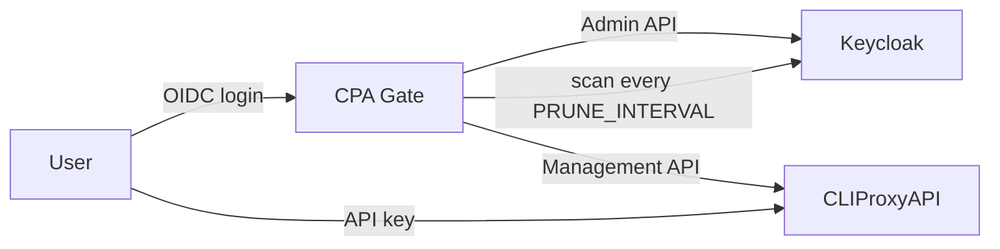

[English](#) | [简体中文](./README.zh-Hans.md)

# CPA Gate

> [!WARNING]
> This project was developed through **Vibe Coding**. Although the code has been
> reviewed by humans, it cannot be guaranteed to be fully controlled and free of
> defects. Please assess the risk before use.

A lightweight, database-free front door for [CLIProxyAPI](https://github.com/router-for-me/CLIProxyAPI).

Users sign in through your existing SSO (OIDC, primarily Keycloak) and receive a personal CLIProxyAPI key. The page shows only what is necessary:

- the API endpoint
- the API key (rotatable)
- quick setup (one-click import into Cherry Studio, Chatbox and OpenCat)
- the currently available models (click a model name to copy it)

## Contents

- [How it works](#how-it-works)
- [Quick start](#quick-start)
- [Configuration](#configuration)
  - [Server](#server)
  - [Branding](#branding)
  - [CLIProxyAPI](#cliproxyapi)
  - [Endpoints shown on the page](#endpoints-shown-on-the-page)
  - [KeyCordon privacy (optional)](#keycordon-privacy-optional)
  - [OIDC](#oidc)
  - [Keycloak login client](#keycloak-login-client)
  - [Keycloak Admin API](#keycloak-admin-api)
  - [Automatic revocation](#automatic-revocation)
- [API](#api)
- [Key format](#key-format)
- [Security notes](#security-notes)
- [Docker](#docker)
- [Continuous integration](#continuous-integration)
- [Development](#development)

## How it works

- **No database.** CLIProxyAPI's own client key list (`/v0/management/api-keys`) is the single source of truth.
- **Self-describing keys.** Every key has the form `<userId>.<random>`, so it can be traced back to its user without a mapping table.
- **SSO-gated issuance.** Before issuing a key, the service asks the Keycloak Admin API whether the user still exists, is enabled, and belongs to one of the configured groups.
- **Revocation by scan.** The service periodically scans every managed key and deletes those held by users who were removed, disabled or moved out of the allowed groups.



## Quick start

Requirements: Node.js >= 20.19, pnpm >= 11.

```bash
pnpm install
cp .env.example .env
# edit .env; at minimum SESSION_SECRET and CPA_MANAGEMENT_*
pnpm dev
```

Production build:

```bash
pnpm build
node dist/index.js
```

## Configuration

### Server

| Variable | Default | Description |
| --- | --- | --- |
| `SERVER_HOST` | `0.0.0.0` | Listen address |
| `SERVER_PORT` | `3001` | Listen port |
| `ENV_PRODUCT` | `development` | Set to `production` to enable Secure cookies |
| `SESSION_SECRET` | — | **Required, at least 32 bytes.** HMAC key for the session JWT; a shorter value aborts startup |
| `SESSION_COOKIE_NAME` | `cpa_session` | Session cookie name |
| `SESSION_TTL` | `604800` | Session lifetime (seconds) |

### Branding

Six optional variables, three per language:

| Variable | Default | Description |
| --- | --- | --- |
| `SITE_TITLE_ZH_HANS` | `CPA Gate` | Browser title, top-bar brand and page heading (zh-Hans) |
| `SITE_SUBTITLE_ZH_HANS` | `CLIProxyAPI` | Small label next to the brand (zh-Hans) |
| `SITE_DESCRIPTION_ZH_HANS` | locale `tagline` | Page subtitle and `<meta name="description">` (zh-Hans) |
| `SITE_TITLE_EN` | `CPA Gate` | Same, English UI |
| `SITE_SUBTITLE_EN` | `CLIProxyAPI` | Same, English UI |
| `SITE_DESCRIPTION_EN` | locale `tagline` | Same, English UI |

Any field left empty falls back to the built-in locale text, so only the fields you need must be overridden:

```env
SITE_TITLE_ZH_HANS=知行 AI 网关
SITE_DESCRIPTION_ZH_HANS=登录后获取你的 CLIProxyAPI 密钥
SITE_TITLE_EN=ZhiXing AI Gateway
SITE_DESCRIPTION_EN=Sign in to get your CLIProxyAPI key
```

### CLIProxyAPI

| Variable | Default | Description |
| --- | --- | --- |
| `CPA_MANAGEMENT_URL` | — | **Required.** Management API base, without `/v0/management` |
| `CPA_MANAGEMENT_KEY` | — | **Required.** CLIProxyAPI management key |
| `CPA_API_BASE_URL` | management URL | Public base shown to users; display only. Model lookups always go through `CPA_MANAGEMENT_URL` |
| `CPA_TIMEOUT_MS` | `10000` | Upstream request timeout |
| `MODELS_CACHE_TTL` | `60` | Model list cache duration in seconds; `0` disables caching |

If CPA Gate and CLIProxyAPI are not on the same host, enable remote management in CLIProxyAPI:

```yaml
remote-management:
  allow-remote: true
  secret-key: <management-key>
```

### Endpoints shown on the page

CLIProxyAPI exposes several compatible protocol prefixes on the same port, so the page lists all of them (each with a copy button):

| Client | Variable to set | Base URL shown | Complete path shown when **Full URL** is on |
| --- | --- | --- | --- |
| OpenAI SDK / Codex CLI (Chat Completions) | `OPENAI_BASE_URL` | `${CPA_API_BASE_URL}/v1` | `${CPA_API_BASE_URL}/v1/chat/completions` |
| Claude Code | `ANTHROPIC_BASE_URL` | `${CPA_API_BASE_URL}` | `${CPA_API_BASE_URL}/v1/messages` |
| Gemini CLI | `GOOGLE_GEMINI_BASE_URL` | `${CPA_API_BASE_URL}/v1beta` | `${CPA_API_BASE_URL}/v1beta/models/{model}:generateContent` |

The first row is the primary endpoint; the rest are listed underneath. The **Full URL** switch in that section (off by default) swaps every address from the base URL that belongs in a client's environment variable to a complete callable path. The choice is stored in `localStorage`, and the copy button always copies what is currently displayed. The Anthropic entry deliberately carries **no** `/v1` suffix: Claude Code appends `/v1/messages` itself, so pointing it at `/v1` would produce `/v1/v1/messages`.

### KeyCordon privacy (optional)

[KeyCordon](https://gitlab.soraharu.com/XiaoXi/keycordon) is a reverse proxy for LLM APIs. Before a request leaves the machine it replaces API keys, tokens, private keys and connection-string passwords in the request body with placeholders, then restores them before the response reaches the client. The upstream model never sees the original secrets.

When enabled, the endpoint section gains a **KeyCordon privacy** switch (left of **Full URL**). With the switch on, all three endpoints and the quick-config deep links point at KeyCordon; with it off they return to the direct addresses.

| Variable | Default | Description |
| --- | --- | --- |
| `KEYCORDON_ENABLED` | `false` | Set to `true` to make `/api/portal` include the KeyCordon addresses and the page render the switch |
| `KEYCORDON_URL` | — | The **externally reachable** KeyCordon address clients will use, e.g. `https://kc.example.com`. Required when enabled; display only, the server never connects to it |
| `KEYCORDON_DEFAULT_ON` | `false` | Initial state of the switch; once the user toggles it, `localStorage` takes precedence |

When the integration is disabled, `/api/portal` omits the `keycordon` field entirely and the page stays identical to the pre-integration behaviour.

`KEYCORDON_URL` is only format-checked (http/https); reachability is never probed, so a misconfiguration shows up as "the address copies fine but nothing answers". A loopback value (`localhost` / `127.0.0.1`) logs a warning at startup, because clients cannot reach the server's own loopback address.

#### Using the `-keycordon` image

The `latest-keycordon` tag runs cpa-gate (3001) and keycordon (8318) in a single container, so keycordon does not need to be deployed separately:

```bash
docker run -d --name cpa-gate \
  -p 3001:3001 \
  -p 127.0.0.1:8318:8318 \
  -e CPA_MANAGEMENT_URL='http://cliproxyapi:8317' \
  -e CPA_MANAGEMENT_KEY='…' \
  -e SESSION_SECRET='…' \
  -e KEYCORDON_ENABLED=true \
  -e KEYCORDON_URL='https://kc.example.com' \
  -e KEYCORDON_MASTER_KEY="$(head -c 32 /dev/urandom | od -An -tx1 | tr -d ' \n')" \
  docker.io/yanranxiaoxi/cpa-gate:latest-keycordon
```

That image reads two additional variables:

| Variable | Default | Description |
| --- | --- | --- |
| `KEYCORDON_UPSTREAM` | `$CPA_MANAGEMENT_URL` | Upstream for the bundled keycordon (must be reachable from inside the container) |
| `KEYCORDON_MASTER_KEY` | — | **Required.** Master key, hex or base64, at least 32 bytes; the container refuses to start without it |

Do not confuse `KEYCORDON_URL` (external, shown to browsers) with `KEYCORDON_UPSTREAM` (internal, used by keycordon).

**Changing the master key invalidates every existing placeholder** and forces the upstream to recompute its prompt cache. Store it as a long-lived secret.

#### Reverse proxy

Port 8318 must be exposed by the deployer, who is also responsible for the certificate (optional). Two requirements apply:

1. **Forward client credentials unchanged**: `Authorization`, `x-api-key`, `x-goog-api-key`, `?key=`, `?auth_token=`. keycordon partitions its vault by these values; dropping them makes every client share a single vault, so one client's placeholders become restorable by another.
2. **Disable response buffering**: LLM responses are streamed, and nginx's default buffering makes requests appear to hang.

```nginx
server {
    listen 443 ssl;
    server_name kc.example.com;

    # keycordon caps request bodies at 8 MiB; nginx defaults to 1 MB and would 413 first
    client_max_body_size 16m;

    location / {
        proxy_pass http://127.0.0.1:8318;
        proxy_http_version 1.1;
        proxy_buffering off;
        proxy_set_header Host $host;
        # nginx defaults, spelled out so they are not removed by accident
        proxy_set_header Authorization $http_authorization;
        proxy_set_header X-Api-Key $http_x_api_key;
        proxy_set_header X-Goog-Api-Key $http_x_goog_api_key;
    }
}
```

Caddy's defaults already satisfy both requirements, provided `request_header -Authorization` is not added:

```text
kc.example.com {
    reverse_proxy 127.0.0.1:8318
}
```

**Abuse protection is the deployer's responsibility**: 8318 is a new public entry point, so rate and concurrency limits belong at the reverse proxy.

#### Rollout and troubleshooting

- To observe before enforcing: mount a configuration over `/etc/keycordon/config.yaml` and set `mode: observe` (log detections, rewrite nothing); switch back to `enforce` once the detections are trusted.
- To roll back: set `KEYCORDON_DEFAULT_ON=false`; users return to the direct addresses while keycordon keeps logging.
- Request bodies over 8 MiB (for example several images in one request) receive a 413 and are **not** passed through. Mount a configuration with a larger `limits.max_body_bytes` if required, keeping in mind that memory is roughly "concurrency × `max_decoded_bytes`".
- Health check: `curl http://127.0.0.1:8318/_keycordon/healthz` returns the version, mode and master-key fingerprint (no authentication required).
- If either process exits, the whole container exits (fail fast), so the switch can never report "on" while nothing is listening.

### OIDC

| Variable | Default | Description |
| --- | --- | --- |
| `OIDC_ISSUER` | — | e.g. `https://sso.example.com/realms/main` |
| `OIDC_CLIENT_ID` | — | OIDC client ID |
| `OIDC_CLIENT_SECRET` | — | OIDC client secret |
| `OIDC_REDIRECT_URI` | — | e.g. `https://cpa-gate.example.com/api/auth/callback` |
| `OIDC_SCOPE` | `openid profile email` | Requested scopes |
| `OIDC_USERNAME_CLAIM` | `preferred_username` | Display name claim |
| `OIDC_USER_ID_CLAIM` | `sub` | Claim used as the key prefix (must be the real Keycloak user ID) |
| `OIDC_PROVIDER_NAME` | empty | Text on the login button |
| `OIDC_ACCOUNT_URL` | empty | Optional user center link (http/https only) |
| `OIDC_POST_LOGOUT_REDIRECT_URI` | site root | RP-initiated logout return URL |
| `OIDC_ALLOW_INSECURE` | `false` | Allow `http://` issuers for local testing only |

### Keycloak login client

Register the sign-in client separately from the admin client described below:

1. **Clients → Create client**
   - Client type: `OpenID Connect`
   - Client ID: `cpa-gate` (this becomes `OIDC_CLIENT_ID`)
2. **Capability config**
   - Client authentication: **On** (confidential; copy the secret from the Credentials tab into `OIDC_CLIENT_SECRET`)
   - Standard flow: **On** (authorization code + PKCE S256)
   - Implicit flow / Direct access grants / Service accounts roles: **Off**
3. **Settings → Valid redirect URIs**: must match `OIDC_REDIRECT_URI` **exactly**.

   ```
   https://cpa-gate.example.com/api/auth/callback
   ```

   For local development, add a second entry: `http://localhost:3001/api/auth/callback`.
4. **Settings → Valid post logout redirect URIs**: the RP-initiated logout target, i.e. the site root.

   ```
   https://cpa-gate.example.com/
   ```

   The "Sign out of SSO" button returns to this address; when `OIDC_POST_LOGOUT_REDIRECT_URI` is unset it defaults to the origin of `OIDC_REDIRECT_URI`.
5. **Settings → Advanced → Subject Type**: `public`. With `pairwise`, `sub` is an opaque per-client identifier and can be used neither as the key prefix nor with the Admin API.
6. **Web origins**: may be left empty (all requests are same-origin through this service).

The resulting mapping is:

| Keycloak field | Value |
| --- | --- |
| Valid redirect URI | `${OIDC_PUBLIC_ORIGIN}/api/auth/callback` |
| Valid post logout redirect URI | `${OIDC_PUBLIC_ORIGIN}/` |

If CPA Gate sits behind a path-prefixed reverse proxy (e.g. `https://example.com/cpa-gate/`), the callback becomes `https://example.com/cpa-gate/api/auth/callback`, and the proxy must forward that path unchanged.

### Keycloak Admin API

`KEYCLOAK_ADMIN_CLIENT_ID` and `KEYCLOAK_ADMIN_CLIENT_SECRET` come from a **separate** confidential client used only for Admin REST calls. It is created once:

1. **Clients → Create client**
   - Client type: `OpenID Connect`
   - Client ID: `cpa-gate-admin` (arbitrary name; this becomes `KEYCLOAK_ADMIN_CLIENT_ID`)
2. **Capability config**
   - Client authentication: **On**
   - Authorization: Off
   - Standard flow / Implicit flow / Direct access grants: **Off**
   - Service accounts roles: **On**
3. Save, then open the **Credentials** tab and copy **Client secret** into `KEYCLOAK_ADMIN_CLIENT_SECRET`.
4. Open the **Service accounts roles** tab → **Assign role** → filter by client `realm-management` → select:
   - `view-users` (read user profile, enabled flag, username and email)
   - `query-groups` (list the groups a user belongs to)
5. **Keycloak 26.8.2 and later: assign the `kc-admin-api` client scope** (skipping this breaks sign-in)
   - **Client scopes** tab → **Add client scope** → tick `kc-admin-api` → **Add** → choose **Default**
   - Why: since 26.8.2 (CVE-2026-19688) the Admin REST API enforces the token audience, so tokens must carry the `kc-admin-api` scope. The upgrade assigns it only to the built-in clients (`admin-cli`, `security-admin-console`); custom service accounts must add it manually
   - Symptom: the page reports that the account status cannot be verified and the log shows `GET /users/… returned 401`; this service appends the `www-authenticate` header and hints at the required scope
6. Verify the credentials with curl:

```bash
curl -s -X POST \
  "$OIDC_ORIGIN/realms/$REALM/protocol/openid-connect/token" \
  -d grant_type=client_credentials \
  -d client_id=cpa-gate-admin \
  -d client_secret='…'
```

A JSON body containing `access_token` confirms the credentials. Then verify the permissions:

```bash
curl -s -H "Authorization: Bearer $TOKEN" \
  "$OIDC_ORIGIN/admin/realms/$REALM/users/$USER_UUID"
curl -s -H "Authorization: Bearer $TOKEN" \
  "$OIDC_ORIGIN/admin/realms/$REALM/users/$USER_UUID/groups"
```

A `200` from both requests confirms that the role assignment is sufficient. A `403` here causes the service to refuse sign-ins (`?login=unavailable`) and to keep the affected keys during pruning.

If a freshly issued token returns `401` instead of `403`, the `kc-admin-api` scope from step 5 is most likely missing (Keycloak 26.8.2+).

> Do not grant `realm-admin`, and do not reuse `OIDC_CLIENT_ID` / `OIDC_CLIENT_SECRET`: the login client must remain public and carry no admin roles, while the admin client must not enable any browser flow.

| Variable | Default | Description |
| --- | --- | --- |
| `ALLOWED_GROUPS` | — | Comma-separated or JSON array; group names (`ai`) or paths (`/staff/ai`) |
| `ALLOWED_USERS` | — | Comma-separated or JSON array of specific users: UUID, username or email |
| `KEYCLOAK_ADMIN_BASE_URL` | derived from issuer | e.g. `https://sso.example.com` |
| `KEYCLOAK_REALM` | derived from issuer | e.g. `main` |
| `KEYCLOAK_ADMIN_CLIENT_ID` | — | Service account client ID |
| `KEYCLOAK_ADMIN_CLIENT_SECRET` | — | Service account secret |
| `KEYCLOAK_ADMIN_TIMEOUT_MS` | `10000` | Admin API timeout |

The service account requires the `realm-management` roles `view-users` and `query-groups`.

Group matching walks ancestor paths: a user in `/staff/ai/llm` matches `/staff/ai`, while a user only in `/staff/ai` does **not** match `/staff/ai/llm`.

`ALLOWED_GROUPS` and `ALLOWED_USERS` are combined with **OR** (union); at least one of them must be configured when login is enabled.

`ALLOWED_USERS` entries are matched case-insensitively against the user's UUID, username and email. A `uuid:`, `username:` or `email:` prefix restricts an entry to a single field:

```env
ALLOWED_GROUPS=/staff/ai
ALLOWED_USERS=0f8fad5b-d9cb-469f-a165-70867728950e,email:contractor@example.com,username:guest-dev
```

When a user is rejected, the page displays that user's own UUID with a copy button so it can be forwarded to the administrator for allowlisting; the same ID is shown when a signed-in user loses access.

### Automatic revocation

| Variable | Default | Description |
| --- | --- | --- |
| `PRUNE_INTERVAL` | `1800` | Seconds between scans; `0` disables the scan entirely |

The service scans every managed key on that interval and deletes those held by users who were removed, disabled or moved out of the allowed groups. Revocation relies entirely on this scan, since signing in only guards new issuance; it therefore takes effect within one interval.

Each scan logs one summary line:

```text
[prune] scanned=12 managed=10 valid=9 removed=1 errors=0
```

On Keycloak errors (timeouts, 5xx, 401/403) the scan **keeps** the affected keys and emits an additional error line, because silently skipping a user would disable revocation without notice:

```text
[prune] 2 user(s) could not be verified, their keys were kept: [{"userId":"…","reason":"keycloak_unavailable"}]
```

Alerting on that second line is recommended. The mechanism needs neither an extra endpoint nor an external cron job.

## API

| Method | Path | Auth | Purpose |
| --- | --- | --- | --- |
| `GET` | `/api/config` | — | Public configuration (endpoints and site text) |
| `GET` | `/api/auth/status` | — | Session status |
| `GET` | `/api/auth/login` | — | Redirect to the identity provider |
| `GET` | `/api/auth/callback` | — | OIDC callback |
| `GET` | `/api/auth/logout` | — | Sign out; `?sso=1` also ends the identity-provider session. Same-origin requests only |
| `GET` | `/api/portal` | Session | Endpoints, API key, available models |
| `POST` | `/api/token/rotate` | Session | Rotate the API key |

## Key format

```text
<userId>.<32-byte base64url>
```

Only keys matching `^([\w-]{1,128})\.([\w-]{43})$` are managed by this service; any other key is left untouched by rotation and pruning.

## Security notes

- The management key and SSO secrets never reach the browser.
- Keys are returned only by authenticated `no-store` responses and are masked in logs.
- Login fails closed when Keycloak cannot be reached; pruning fails safe (keeps keys).
- A user whose key was pruned cannot obtain a new one by refreshing the page: `/api/portal` re-checks Keycloak before recreating a missing key.
- The rotate and logout endpoints accept same-origin requests only, so they cannot be triggered cross-site.
- A rejected login displays only the user's own UUID, held in a 5-minute signed cookie (cleared on a new login attempt or a successful sign-in) and never placed in the URL.
- All responses carry strict CSP and related security headers; the container runs as a non-root user.

## Docker

Published image: [`docker.io/yanranxiaoxi/cpa-gate`](https://hub.docker.com/r/yanranxiaoxi/cpa-gate) (`latest` follows the default branch).

Two tags:

| Tag | Contents |
| --- | --- |
| `latest` | cpa-gate only, listening on 3001 |
| `latest-keycordon` | cpa-gate and keycordon, listening on 3001 and 8318 (see [KeyCordon privacy](#keycordon-privacy-optional)) |

The container runs as the unprivileged `node` user with only `./logs` writable; mount that directory to persist logs.

```bash
docker run -d --name cpa-gate \
  -p 3001:3001 \
  -e CPA_MANAGEMENT_URL='http://cliproxyapi:8317' \
  -e CPA_MANAGEMENT_KEY='…' \
  -e OIDC_ISSUER='https://sso.example.com/realms/main' \
  -e OIDC_CLIENT_ID='cpa-gate' \
  -e OIDC_CLIENT_SECRET='…' \
  -e OIDC_REDIRECT_URI='https://cpa-gate.example.com/api/auth/callback' \
  -e ALLOWED_GROUPS='/staff/ai' \
  -e KEYCLOAK_ADMIN_CLIENT_ID='cpa-gate-admin' \
  -e KEYCLOAK_ADMIN_CLIENT_SECRET='…' \
  -e SESSION_SECRET='…' \
  -e PRUNE_INTERVAL=1800 \
  docker.io/yanranxiaoxi/cpa-gate:latest
```

To build locally and use a custom tag instead:

```bash
pnpm build
docker build -t cpa-gate .
docker run -d --name cpa-gate -p 3001:3001 \
  -e CPA_MANAGEMENT_KEY='…' \
  -e SESSION_SECRET='…' \
  cpa-gate
```

The image is also published to the GitLab registry as `registry.gitlab.soraharu.com/xiaoxi/cpa-gate:latest`. It runs `pnpm install --prod` and copies `dist/` (backend + `public/`). `CPA_MANAGEMENT_URL` defaults to `http://127.0.0.1:8317`; override it when CLIProxyAPI runs in another container.

The `-keycordon` image is built by pulling the latest release (excluding `nightly`) of the `linux_amd64` static binary from [keycordon's package registry](https://gitlab.soraharu.com/XiaoXi/keycordon/-/packages) and baking it into the image. The image is therefore **not reproducible**: each build may carry a different keycordon version. Inspect the `org.opencontainers.image.keycordon.version` label with `docker inspect` when troubleshooting. A local build requires downloading the binary first:

```bash
curl -fL -o keycordon-integration/keycordon-linux-amd64 \
  "https://gitlab.soraharu.com/api/v4/projects/168/packages/generic/keycordon/<version>/keycordon_<version>_linux_amd64"
chmod 0755 keycordon-integration/keycordon-linux-amd64
pnpm build
docker build -f Dockerfile.keycordon --build-arg KEYCORDON_VERSION=<version> -t cpa-gate:keycordon .
```

## Continuous integration

The pipeline runs on the **default branch** only, and can be started in two ways:

| Trigger | `CI_PIPELINE_SOURCE` | Notes |
| --- | --- | --- |
| Push to the default branch | `push` | The normal development flow |
| Pipeline trigger token + API call | `trigger` | Rebuild without changing code, e.g. a new keycordon release or an updated base image |

Merge requests, tag pushes, pushes to other branches, manual web runs and scheduled pipelines never create a pipeline, so they cannot trigger an image build or push.

### Using a trigger token

1. Open the project and go to **Settings → CI/CD → Pipeline trigger tokens**, click **Add new token**, then copy the token value.
2. Pass it through an environment variable so the token does not end up in shell history or a process argument list:

```bash
export GITLAB_TRIGGER_TOKEN='…'

curl --fail --request POST \
  --form "token=$GITLAB_TRIGGER_TOKEN" \
  --form ref=main \
  "https://gitlab.soraharu.com/api/v4/projects/164/trigger/pipeline"
```

The parameters may also go in the query string (the token then appears in the process list and access logs, so this is only advisable in throwaway scripts):

```bash
curl --fail --request POST \
  "https://gitlab.soraharu.com/api/v4/projects/164/trigger/pipeline?token=$GITLAB_TRIGGER_TOKEN"
```

Notes:

- Only **POST** works; `GET` returns `404`.
- `ref` must be the default branch name, otherwise `workflow:rules` rejects the pipeline and the API returns `400`.
- The response body carries the new pipeline's `id`, `status` and `web_url`.
- A trigger token grants maintainer-level access to the project, so treat it as a secret; revoke it under **Pipeline trigger tokens** as soon as it leaks (revocation cannot be undone).
- The token can only create pipelines; it cannot read repository contents or CI/CD variables.

## Development

```bash
pnpm dev        # backend and frontend watch
pnpm typecheck  # type checking
pnpm lint       # linting
pnpm build      # production build
```

The UI, SSO flow, theming, i18n and build pipeline are shared with `LibreTranslate-FrontPage` and `pingatlas`, keeping the three services consistent.

See [SPECS.md](./SPECS.md) for the complete design document.
