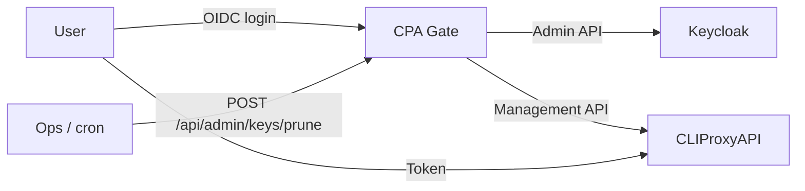

[English](#) | [简体中文](./README.zh-Hans.md)

# CPA Gate

> [!WARNING]
> This project was written through **Vibe Coding**. Although the code has been
> reviewed by humans, it cannot be guaranteed to be 100% controlled or
> bug-free. Use it at your own risk.

A small, database-free entry point for [CLIProxyAPI](https://github.com/router-for-me/CLIProxyAPI).

Users sign in with your existing SSO (OIDC, Keycloak friendly) and receive a personal CLIProxyAPI key. The page only shows what matters:

- the API endpoint
- the personal token (with rotation)
- the currently available models

## How it works

- **No database.** CLIProxyAPI's own client key list (`/v0/management/api-keys`) is the single source of truth.
- **Self-describing keys.** Every key is `<userId>.<random>`, so a key can be traced back to its user without a mapping table.
- **SSO-gated issuance.** Before issuing a key, the service asks the Keycloak Admin API whether the user still exists, is enabled, and belongs to one of the configured groups.
- **Revocation by scan.** A key-protected maintenance endpoint scans all managed keys and removes those whose user was deleted, disabled, or moved out of the allowed groups.



## Quick start

Requirements: Node.js >= 20.19, pnpm >= 10.

```bash
pnpm install
cp .env.example .env
# edit .env
pnpm dev
```

Production build:

```bash
pnpm build
node dist/index.js
```

## Configuration

### Server

| Variable | Default | Description |
| --- | --- | --- |
| `SERVER_HOST` | `0.0.0.0` | Listen address |
| `SERVER_PORT` | `3001` | Listen port |
| `ENV_PRODUCT` | `development` | `production` enables Secure cookies |
| `SESSION_SECRET` | — | **Required.** HMAC key for session JWT (32+ random bytes) |
| `SESSION_COOKIE_NAME` | `cpa_session` | Session cookie name |
| `SESSION_TTL` | `604800` | Session lifetime (seconds) |

### CLIProxyAPI

| Variable | Default | Description |
| --- | --- | --- |
| `CPA_MANAGEMENT_URL` | — | **Required.** Management API base, without `/v0/management` |
| `CPA_MANAGEMENT_KEY` | — | **Required.** CLIProxyAPI management key |
| `CPA_API_BASE_URL` | management URL | Public API base shown to users; the page displays `${CPA_API_BASE_URL}/v1` |
| `CPA_TIMEOUT_MS` | `10000` | Upstream timeout |
| `MODELS_CACHE_TTL` | `60` | Model list cache in seconds (`0` disables) |

If CPA Gate is not on the same host as CLIProxyAPI, enable remote management in CLIProxyAPI:

```yaml
remote-management:
  allow-remote: true
  secret-key: <management-key>
```

### OIDC

| Variable | Default | Description |
| --- | --- | --- |
| `OIDC_ISSUER` | — | e.g. `https://sso.example.com/realms/main` |
| `OIDC_CLIENT_ID` | — | OIDC client ID |
| `OIDC_CLIENT_SECRET` | — | OIDC client secret |
| `OIDC_REDIRECT_URI` | — | e.g. `https://cpa-gate.example.com/api/auth/callback` |
| `OIDC_SCOPE` | `openid profile email` | Requested scopes |
| `OIDC_USERNAME_CLAIM` | `preferred_username` | Display name claim |
| `OIDC_USER_ID_CLAIM` | `sub` | Claim used as the key prefix (must be the real Keycloak user ID) |
| `OIDC_PROVIDER_NAME` | empty | Text on the login button |
| `OIDC_ACCOUNT_URL` | empty | Optional user center link (http/https only) |
| `OIDC_POST_LOGOUT_REDIRECT_URI` | site root | RP-initiated logout return URL |
| `OIDC_ALLOW_INSECURE` | `false` | Allow `http://` issuers for local testing only |

> Keycloak clients must use the `public` subject type. With `pairwise`, `sub` is not the real user UUID and cannot be used with the Admin API.

### Keycloak Admin API

| Variable | Default | Description |
| --- | --- | --- |
| `ALLOWED_GROUPS` | — | Comma-separated or JSON array; group names (`ai`) or paths (`/staff/ai`) |
| `ALLOWED_USERS` | — | Comma-separated or JSON array of specific users: UUID, username or email |
| `KEYCLOAK_ADMIN_BASE_URL` | derived from issuer | e.g. `https://sso.example.com` |
| `KEYCLOAK_REALM` | derived from issuer | e.g. `main` |
| `KEYCLOAK_ADMIN_CLIENT_ID` | — | Service account client ID |
| `KEYCLOAK_ADMIN_CLIENT_SECRET` | — | Service account secret |
| `KEYCLOAK_ADMIN_TIMEOUT_MS` | `10000` | Admin API timeout |

The service account needs the realm-management roles `view-users`, `query-groups`, and `view-groups`.

Group matching walks ancestor paths: a user in `/staff/ai/llm` matches `/staff/ai`. A user only in `/staff/ai` does **not** match `/staff/ai/llm`.

`ALLOWED_GROUPS` and `ALLOWED_USERS` are combined with **OR** (union). At least one of them must be set when login is enabled.

`ALLOWED_USERS` entries are matched case-insensitively against the user's UUID, username, and email. Use a `uuid:`, `username:`, or `email:` prefix to restrict an entry to one field:

```env
ALLOWED_GROUPS=/staff/ai
ALLOWED_USERS=0f8fad5b-d9cb-469f-a165-70867728950e,email:contractor@example.com,username:guest-dev
```

Tip: when a user is rejected, the page shows that user's own UUID with a copy button, so they can send it to you for allowlisting. The same ID is shown if a signed-in user loses access.

### Maintenance endpoint

| Variable | Default | Description |
| --- | --- | --- |
| `PRUNE_API_KEY` | empty | When empty, `POST /api/admin/keys/prune` returns 404 |

```bash
curl -X POST \
  -H "X-Admin-Key: $PRUNE_API_KEY" \
  "https://cpa-gate.example.com/api/admin/keys/prune"

# dry run
curl -X POST -H "X-Admin-Key: $PRUNE_API_KEY" \
  "https://cpa-gate.example.com/api/admin/keys/prune?dryRun=true"
```

Run it from cron frequently, for example every 10 minutes. Keys are only revoked by this scan; login checks only guard new issuance. Keycloak errors (timeout, 5xx, 401/403) make the scan **keep** keys and report them under `errors`.

## API

| Method | Path | Auth | Purpose |
| --- | --- | --- | --- |
| `GET` | `/api/config` | — | Public config (`callUrl`) |
| `GET` | `/api/auth/status` | — | Session status |
| `GET` | `/api/auth/login` | — | Redirect to the IdP |
| `GET` | `/api/auth/callback` | — | OIDC callback |
| `GET` | `/api/auth/logout` | — | Sign out; `?sso=1` also ends the IdP session |
| `GET` | `/api/portal` | Session | Endpoint, token, models |
| `POST` | `/api/token/rotate` | Session | Rotate the personal token |
| `POST` | `/api/admin/keys/prune` | `PRUNE_API_KEY` | Remove keys of ineligible users |

## Key format

```text
<userId>.<32-byte base64url>
```

Only keys matching `^([\w-]{1,128})\.([\w-]{43})$` are managed by this service. Anything else is left untouched by rotation and pruning.

## Security notes

- The management key and SSO secrets never reach the browser.
- Tokens are only returned by authenticated, `no-store` responses and are masked in logs.
- The maintenance endpoint uses constant-time comparison and returns 404 when unconfigured.
- Login fails closed when Keycloak cannot be reached; pruning fails safe (keeps keys).
- A user whose key was pruned cannot get it back by refreshing the page: `/api/portal` re-checks Keycloak before recreating a missing key.
- A rejected login only displays the user's own UUID, stored in a short-lived signed cookie (5 minutes, cleared on a new login attempt or a successful sign-in), never in the URL.

## Docker

```bash
pnpm build
docker build -t cpa-gate .
docker run -p 3001:3001 \
  -e CPA_MANAGEMENT_KEY='…' \
  -e OIDC_ISSUER='https://sso.example.com/realms/main' \
  -e OIDC_CLIENT_ID='cpa-gate' \
  -e OIDC_CLIENT_SECRET='…' \
  -e OIDC_REDIRECT_URI='https://cpa-gate.example.com/api/auth/callback' \
  -e ALLOWED_GROUPS='/staff/ai' \
  -e KEYCLOAK_ADMIN_CLIENT_ID='cpa-gate-admin' \
  -e KEYCLOAK_ADMIN_CLIENT_SECRET='…' \
  -e SESSION_SECRET='…' \
  -e PRUNE_API_KEY='…' \
  cpa-gate
```

The image runs `pnpm install --prod` and copies `dist/` (backend + `public/`). `CPA_MANAGEMENT_URL` defaults to `http://127.0.0.1:8317`; override it when CLIProxyAPI runs in another container.

## Development

```bash
pnpm dev        # backend + frontend watch
pnpm typecheck
pnpm lint
pnpm build
```

The UI, SSO flow, theme, i18n and build pipeline are shared with `LibreTranslate-FrontPage` and `pingatlas` so the three services look and behave the same.

See [SPECS.md](./SPECS.md) for the full design document.
