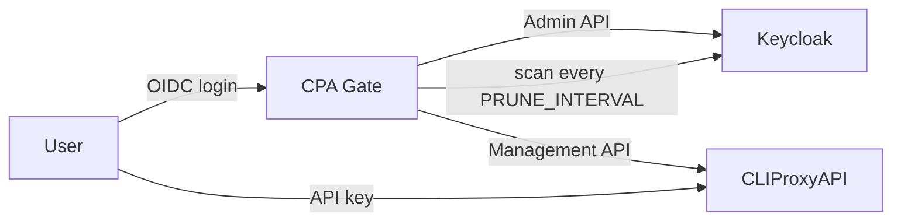

[English](#) | [简体中文](./README.zh-Hans.md)

# CPA Gate

> [!WARNING]
> This project was written through **Vibe Coding**. Although the code has been
> reviewed by humans, it cannot be guaranteed to be 100% controlled or
> bug-free. Use it at your own risk.

A small, database-free entry point for [CLIProxyAPI](https://github.com/router-for-me/CLIProxyAPI).

Users sign in with your existing SSO (OIDC, Keycloak friendly) and receive a personal CLIProxyAPI key. The page only shows what matters:

- the API endpoint
- the API key (with rotation)
- quick setup (one-click import into Cherry Studio, Chatbox, OpenCat)
- the currently available models (click any model to copy its name)

## How it works

- **No database.** CLIProxyAPI's own client key list (`/v0/management/api-keys`) is the single source of truth.
- **Self-describing keys.** Every key is `<userId>.<random>`, so a key can be traced back to its user without a mapping table.
- **SSO-gated issuance.** Before issuing a key, the service asks the Keycloak Admin API whether the user still exists, is enabled, and belongs to one of the configured groups.
- **Revocation by scan.** The service periodically scans all managed keys and removes those whose user was deleted, disabled, or moved out of the allowed groups.



## Quick start

Requirements: Node.js >= 20.19, pnpm >= 10.

```bash
pnpm install
cp .env.example .env
# edit .env
pnpm dev
```

Production build:

```bash
pnpm build
node dist/index.js
```

## Configuration

### Server

| Variable | Default | Description |
| --- | --- | --- |
| `SERVER_HOST` | `0.0.0.0` | Listen address |
| `SERVER_PORT` | `3001` | Listen port |
| `ENV_PRODUCT` | `development` | `production` enables Secure cookies |
| `SESSION_SECRET` | — | **Required, at least 32 bytes.** HMAC key for session JWT; a shorter value aborts startup |
| `SESSION_COOKIE_NAME` | `cpa_session` | Session cookie name |
| `SESSION_TTL` | `604800` | Session lifetime (seconds) |

### Branding

Six optional variables, three per language:

| Variable | Default | Description |
| --- | --- | --- |
| `SITE_TITLE_ZH_HANS` | `CPA Gate` | Browser title, top-bar brand and page heading (zh-Hans) |
| `SITE_SUBTITLE_ZH_HANS` | `CLIProxyAPI` | Small label next to the brand (zh-Hans) |
| `SITE_DESCRIPTION_ZH_HANS` | locale tagline | Page subtitle and `<meta name="description">` (zh-Hans) |
| `SITE_TITLE_EN` | `CPA Gate` | Same, English UI |
| `SITE_SUBTITLE_EN` | `CLIProxyAPI` | Same, English UI |
| `SITE_DESCRIPTION_EN` | locale tagline | Same, English UI |

Each field falls back to the built-in locale text when empty, so you can override only the ones you need:

```env
SITE_TITLE_ZH_HANS=知行 AI 网关
SITE_DESCRIPTION_ZH_HANS=登录后获取你的 CLIProxyAPI 密钥
SITE_TITLE_EN=ZhiXing AI Gateway
SITE_DESCRIPTION_EN=Sign in to get your CLIProxyAPI key
```

### CLIProxyAPI

| Variable | Default | Description |
| --- | --- | --- |
| `CPA_MANAGEMENT_URL` | — | **Required.** Management API base, without `/v0/management` |
| `CPA_MANAGEMENT_KEY` | — | **Required.** CLIProxyAPI management key |
| `CPA_API_BASE_URL` | management URL | Public base shown to users; only used for display. Model lookups always go through `CPA_MANAGEMENT_URL` |
| `CPA_TIMEOUT_MS` | `10000` | Upstream timeout |
| `MODELS_CACHE_TTL` | `60` | Model list cache in seconds (`0` disables) |

If CPA Gate is not on the same host as CLIProxyAPI, enable remote management in CLIProxyAPI:

```yaml
remote-management:
  allow-remote: true
  secret-key: <management-key>
```

### Endpoints shown on the page

CLIProxyAPI exposes several compatible protocol prefixes on the same port, so the page lists all of them (each with a copy button):

| Client | Variable to set | Base URL shown | Complete path shown when **Full URL** is on |
| --- | --- | --- | --- |
| OpenAI SDK / Codex CLI (Chat Completions) | `OPENAI_BASE_URL` | `${CPA_API_BASE_URL}/v1` | `${CPA_API_BASE_URL}/v1/chat/completions` |
| Claude Code | `ANTHROPIC_BASE_URL` | `${CPA_API_BASE_URL}` | `${CPA_API_BASE_URL}/v1/messages` |
| Gemini CLI | `GOOGLE_GEMINI_BASE_URL` | `${CPA_API_BASE_URL}/v1beta` | `${CPA_API_BASE_URL}/v1beta/models/{model}:generateContent` |

The first row is the primary "endpoint"; the rest are listed underneath. The **Full URL** switch in that section (off by default) swaps every address from the base URL you put in a client's environment variable to a complete callable path; the choice is stored in `localStorage` and the copy button always copies what is currently displayed. Anthropic deliberately has **no** `/v1` suffix because Claude Code appends `/v1/messages` itself — pointing it at `/v1` would produce `/v1/v1/messages`.

### OIDC

| Variable | Default | Description |
| --- | --- | --- |
| `OIDC_ISSUER` | — | e.g. `https://sso.example.com/realms/main` |
| `OIDC_CLIENT_ID` | — | OIDC client ID |
| `OIDC_CLIENT_SECRET` | — | OIDC client secret |
| `OIDC_REDIRECT_URI` | — | e.g. `https://cpa-gate.example.com/api/auth/callback` |
| `OIDC_SCOPE` | `openid profile email` | Requested scopes |
| `OIDC_USERNAME_CLAIM` | `preferred_username` | Display name claim |
| `OIDC_USER_ID_CLAIM` | `sub` | Claim used as the key prefix (must be the real Keycloak user ID) |
| `OIDC_PROVIDER_NAME` | empty | Text on the login button |
| `OIDC_ACCOUNT_URL` | empty | Optional user center link (http/https only) |
| `OIDC_POST_LOGOUT_REDIRECT_URI` | site root | RP-initiated logout return URL |
| `OIDC_ALLOW_INSECURE` | `false` | Allow `http://` issuers for local testing only |

### Keycloak login client

Register the sign-in client separately from the admin client described below:

1. **Clients → Create client**
   - Client type: `OpenID Connect`
   - Client ID: `cpa-gate` (this becomes `OIDC_CLIENT_ID`)
2. **Capability config**
   - Client authentication: **On** (confidential; set `OIDC_CLIENT_SECRET` from the Credentials tab)
   - Standard flow: **On** (authorization code + PKCE S256)
   - Implicit flow / Direct access grants / Service accounts roles: **Off**
3. **Settings → Valid redirect URIs** — must match `OIDC_REDIRECT_URI` **exactly**:

   ```
   https://cpa-gate.example.com/api/auth/callback
   ```

   For local development add a second entry: `http://localhost:3001/api/auth/callback`.
4. **Settings → Valid post logout redirect URIs** — the RP-initiated logout target, i.e. the site root:

   ```
   https://cpa-gate.example.com/
   ```

   This is what the "Sign out of SSO" button returns to; it defaults to the origin of `OIDC_REDIRECT_URI`.
5. **Settings → Advanced → Subject Type**: `public`. With `pairwise`, `sub` is an opaque per-client identifier and cannot be used as the key prefix or with the Admin API.
6. **Web origins**: leave empty (all requests are same-origin through this service).

So the mapping is:

| Keycloak field | Value |
| --- | --- |
| Valid redirect URI | `${OIDC_PUBLIC_ORIGIN}/api/auth/callback` |
| Valid post logout redirect URI | `${OIDC_PUBLIC_ORIGIN}/` |

If CPA Gate sits behind a path-prefixed reverse proxy (e.g. `https://example.com/cpa-gate/`), the callback is `https://example.com/cpa-gate/api/auth/callback`, and the proxy must forward that path unchanged.

### Keycloak Admin API

> Where do `KEYCLOAK_ADMIN_CLIENT_ID` and `KEYCLOAK_ADMIN_CLIENT_SECRET` come from? They are a **separate** confidential client used only for Admin REST calls. Create it once:

1. **Clients → Create client**
   - Client type: `OpenID Connect`
   - Client ID: `cpa-gate-admin` (any name; this becomes `KEYCLOAK_ADMIN_CLIENT_ID`)
2. **Capability config**
   - Client authentication: **On**
   - Authorization: Off
   - Standard flow / Implicit flow / Direct access grants: **Off**
   - Service accounts roles: **On**
3. **Save**, then open the **Credentials** tab and copy **Client secret** → `KEYCLOAK_ADMIN_CLIENT_SECRET`
4. Open the **Service accounts roles** tab → **Assign role** → filter by client `realm-management` → select
   - `view-users` (read user profile, enabled flag, username and email)
   - `query-groups` (list the groups a user belongs to)
5. Verify with curl:

```bash
curl -s -X POST \
  "$OIDC_ORIGIN/realms/$REALM/protocol/openid-connect/token" \
  -d grant_type=client_credentials \
  -d client_id=cpa-gate-admin \
  -d client_secret='…'
```

A JSON body containing `access_token` means the credentials are correct. Then check the permissions:

```bash
curl -s -H "Authorization: Bearer $TOKEN" \
  "$OIDC_ORIGIN/admin/realms/$REALM/users/$USER_UUID"
curl -s -H "Authorization: Bearer $TOKEN" \
  "$OIDC_ORIGIN/admin/realms/$REALM/users/$USER_UUID/groups"
```

`200` from both means the role assignment is sufficient. A `403` here is exactly what makes the service refuse logins (`?login=unavailable`) and makes pruning keep keys.

> Do not grant `realm-admin`, and do not reuse `OIDC_CLIENT_ID` / `OIDC_CLIENT_SECRET`: the login client must stay a public client without admin roles, and the admin client must have no browser flows.

| Variable | Default | Description |
| --- | --- | --- |
| `ALLOWED_GROUPS` | — | Comma-separated or JSON array; group names (`ai`) or paths (`/staff/ai`) |
| `ALLOWED_USERS` | — | Comma-separated or JSON array of specific users: UUID, username or email |
| `KEYCLOAK_ADMIN_BASE_URL` | derived from issuer | e.g. `https://sso.example.com` |
| `KEYCLOAK_REALM` | derived from issuer | e.g. `main` |
| `KEYCLOAK_ADMIN_CLIENT_ID` | — | Service account client ID |
| `KEYCLOAK_ADMIN_CLIENT_SECRET` | — | Service account secret |
| `KEYCLOAK_ADMIN_TIMEOUT_MS` | `10000` | Admin API timeout |

The service account needs the `realm-management` roles `view-users` and `query-groups`.

Group matching walks ancestor paths: a user in `/staff/ai/llm` matches `/staff/ai`. A user only in `/staff/ai` does **not** match `/staff/ai/llm`.

`ALLOWED_GROUPS` and `ALLOWED_USERS` are combined with **OR** (union). At least one of them must be set when login is enabled.

`ALLOWED_USERS` entries are matched case-insensitively against the user's UUID, username, and email. Use a `uuid:`, `username:`, or `email:` prefix to restrict an entry to one field:

```env
ALLOWED_GROUPS=/staff/ai
ALLOWED_USERS=0f8fad5b-d9cb-469f-a165-70867728950e,email:contractor@example.com,username:guest-dev
```

Tip: when a user is rejected, the page shows that user's own UUID with a copy button, so they can send it to you for allowlisting. The same ID is shown if a signed-in user loses access.

### Automatic revocation

| Variable | Default | Description |
| --- | --- | --- |
| `PRUNE_INTERVAL` | `1800` | Seconds between scans; `0` disables the scan entirely |

The service scans all managed keys on that interval and deletes the ones whose user was deleted, disabled, or moved out of the allowed groups. Keys are only revoked by this scan; signing in only guards new issuance. Revocation therefore takes effect within one interval.

Each scan logs one summary line:

```text
[prune] scanned=12 managed=10 valid=9 removed=1 errors=0
```

Keycloak errors (timeout, 5xx, 401/403) make the scan **keep** the affected keys and surface them as an error line, because silently skipping a user would quietly disable revocation:

```text
[prune] 2 user(s) could not be verified, their keys were kept: [{"userId":"…","reason":"keycloak_unavailable"}]
```

Alert on that second line. It does not need a separate endpoint or an external cron job.

## API

| Method | Path | Auth | Purpose |
| --- | --- | --- | --- |
| `GET` | `/api/config` | — | Public config (`callUrl`) |
| `GET` | `/api/auth/status` | — | Session status |
| `GET` | `/api/auth/login` | — | Redirect to the IdP |
| `GET` | `/api/auth/callback` | — | OIDC callback |
| `GET` | `/api/auth/logout` | — | Sign out; `?sso=1` also ends the IdP session. Same-origin only |
| `GET` | `/api/portal` | Session | Endpoint, API key, models |
| `POST` | `/api/token/rotate` | Session | Rotate the API key |

## Key format

```text
<userId>.<32-byte base64url>
```

Only keys matching `^([\w-]{1,128})\.([\w-]{43})$` are managed by this service. Anything else is left untouched by rotation and pruning.

## Security notes

- The management key and SSO secrets never reach the browser.
- Keys are only returned by authenticated, `no-store` responses and are masked in logs.
- The maintenance endpoint uses constant-time comparison and returns 404 when unconfigured.
- Login fails closed when Keycloak cannot be reached; pruning fails safe (keeps keys).
- A user whose key was pruned cannot get it back by refreshing the page: `/api/portal` re-checks Keycloak before recreating a missing key.
- A rejected login only displays the user's own UUID, stored in a short-lived signed cookie (5 minutes, cleared on a new login attempt or a successful sign-in), never in the URL.

## Docker

Published image: [`docker.io/yanranxiaoxi/cpa-gate`](https://hub.docker.com/r/yanranxiaoxi/cpa-gate) (`latest` follows the default branch).

The container runs as the unprivileged `node` user; only `./logs` is writable, so mount it if you want the logs to outlive the container.

```bash
docker run -d --name cpa-gate \
  -p 3001:3001 \
  -e CPA_MANAGEMENT_URL='http://cliproxyapi:8317' \
  -e CPA_MANAGEMENT_KEY='…' \
  -e OIDC_ISSUER='https://sso.example.com/realms/main' \
  -e OIDC_CLIENT_ID='cpa-gate' \
  -e OIDC_CLIENT_SECRET='…' \
  -e OIDC_REDIRECT_URI='https://cpa-gate.example.com/api/auth/callback' \
  -e ALLOWED_GROUPS='/staff/ai' \
  -e KEYCLOAK_ADMIN_CLIENT_ID='cpa-gate-admin' \
  -e KEYCLOAK_ADMIN_CLIENT_SECRET='…' \
  -e SESSION_SECRET='…' \
  -e PRUNE_INTERVAL=1800 \
  docker.io/yanranxiaoxi/cpa-gate:latest
```

To build locally instead, then run your own tag:

```bash
pnpm build
docker build -t cpa-gate .
docker run -d --name cpa-gate -p 3001:3001 \
  -e CPA_MANAGEMENT_KEY='…' \
  -e SESSION_SECRET='…' \
  cpa-gate
```

The image is also available from the GitLab registry as `registry.gitlab.soraharu.com/xiaoxi/cpa-gate:latest`. It runs `pnpm install --prod` and copies `dist/` (backend + `public/`). `CPA_MANAGEMENT_URL` defaults to `http://127.0.0.1:8317`; override it when CLIProxyAPI runs in another container.

## Development

```bash
pnpm dev        # backend + frontend watch
pnpm typecheck
pnpm lint
pnpm build
```

The UI, SSO flow, theme, i18n and build pipeline are shared with `LibreTranslate-FrontPage` and `pingatlas` so the three services look and behave the same.

See [SPECS.md](./SPECS.md) for the full design document.
