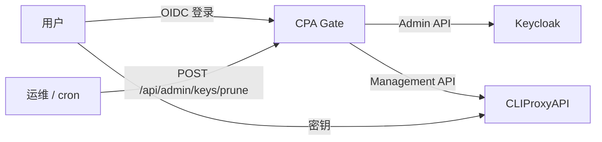

[English](./README.md) | [简体中文](#)

# CPA Gate

> [!WARNING]
> 本项目通过 **Vibe Coding** 方式编写。尽管代码经过人工 review，
> 但仍无法保证 100% 可控、零缺陷，请自行评估风险后使用。

一个面向 [CLIProxyAPI](https://github.com/router-for-me/CLIProxyAPI) 的轻量级、无数据库入口服务。

用户通过现有 SSO（OIDC，主要面向 Keycloak）登录后会获得一枚个人 CLIProxyAPI Key。页面只展示必要信息：

- 调用地址
- API 密钥（支持轮换）
- 快速配置（一键导入 Cherry Studio、Chatbox、OpenCat）
- 当前可用模型（点击模型名即可复制）

## 工作原理

- **无数据库。** CLIProxyAPI 自己的客户端 Key 列表（`/v0/management/api-keys`）就是唯一数据源。
- **Key 自描述。** 每枚 Key 都是 `<userId>.<random>`，不需要映射表即可从 Key 反查用户。
- **SSO 准入。** 发放 Key 前，服务通过 Keycloak Admin API 确认用户仍然存在、已启用，并且在允许的用户组中。
- **扫描式撤销。** 一个由环境变量 Key 鉴权的运维接口会扫描所有受管 Key，删除已删除用户、已禁用用户、已离开允许组的用户的 Key。



## 快速开始

要求：Node.js >= 20.19，pnpm >= 10。

```bash
pnpm install
cp .env.example .env
# 编辑 .env
pnpm dev
```

生产构建：

```bash
pnpm build
node dist/index.js
```

## 配置

### 服务器

| 变量 | 默认值 | 说明 |
| --- | --- | --- |
| `SERVER_HOST` | `0.0.0.0` | 监听地址 |
| `SERVER_PORT` | `3001` | 监听端口 |
| `ENV_PRODUCT` | `development` | `production` 时启用 Secure Cookie |
| `SESSION_SECRET` | — | **必填。** 会话 JWT 的 HMAC 密钥（32+ 随机字节） |
| `SESSION_COOKIE_NAME` | `cpa_session` | 会话 Cookie 名 |
| `SESSION_TTL` | `604800` | 会话有效期（秒） |

### 站点品牌

六个可选变量，每种语言三个：

| 变量 | 默认值 | 说明 |
| --- | --- | --- |
| `SITE_TITLE_ZH_HANS` | `CPA Gate` | 浏览器标题、顶栏品牌名与页面主标题（简体中文） |
| `SITE_SUBTITLE_ZH_HANS` | `CLIProxyAPI` | 顶栏品牌名右侧的小号副标题（简体中文） |
| `SITE_DESCRIPTION_ZH_HANS` | 语言包 tagline | 页面副标题与 `<meta name="description">`（简体中文） |
| `SITE_TITLE_EN` | `CPA Gate` | 同上，英文界面 |
| `SITE_SUBTITLE_EN` | `CLIProxyAPI` | 同上，英文界面 |
| `SITE_DESCRIPTION_EN` | 语言包 tagline | 同上，英文界面 |

某一项留空时回退到该语言的默认文案，因此可以只覆盖需要的字段：

```env
SITE_TITLE_ZH_HANS=知行 AI 网关
SITE_DESCRIPTION_ZH_HANS=登录后获取你的 CLIProxyAPI 密钥
SITE_TITLE_EN=ZhiXing AI Gateway
SITE_DESCRIPTION_EN=Sign in to get your CLIProxyAPI key
```

### CLIProxyAPI

| 变量 | 默认值 | 说明 |
| --- | --- | --- |
| `CPA_MANAGEMENT_URL` | — | **必填。** 管理 API 基址，不含 `/v0/management` |
| `CPA_MANAGEMENT_KEY` | — | **必填。** CLIProxyAPI Management Key |
| `CPA_API_BASE_URL` | 管理地址 | 展示给用户的调用基址，仅用于展示；模型查询始终走 `CPA_MANAGEMENT_URL` |
| `CPA_TIMEOUT_MS` | `10000` | 上游超时（毫秒） |
| `MODELS_CACHE_TTL` | `60` | 模型列表缓存秒数（`0` 表示不缓存） |

如果 CPA Gate 与 CLIProxyAPI 不在同一台主机，需要在 CLIProxyAPI 中开启远程管理：

```yaml
remote-management:
  allow-remote: true
  secret-key: <management-key>
```

### 页面上展示的地址

CLIProxyAPI 在同一端口上提供多套兼容协议，页面会把它们都列出来（每条都可点击复制）：

| 客户端 | 需要设置的环境变量 | 默认展示的基址 | 打开「完整 URL」后展示的完整路径 |
| --- | --- | --- | --- |
| OpenAI SDK / Codex CLI（Chat Completions） | `OPENAI_BASE_URL` | `${CPA_API_BASE_URL}/v1` | `${CPA_API_BASE_URL}/v1/chat/completions` |
| Claude Code | `ANTHROPIC_BASE_URL` | `${CPA_API_BASE_URL}` | `${CPA_API_BASE_URL}/v1/messages` |
| Gemini CLI | `GOOGLE_GEMINI_BASE_URL` | `${CPA_API_BASE_URL}/v1beta` | `${CPA_API_BASE_URL}/v1beta/models/{model}:generateContent` |

第一条是主「调用地址」，其余列在下方。该区块右上角的 **完整 URL** 开关（默认关闭）会把所有地址从「客户端环境变量该填的基址」切换为「可直接调用的完整接口路径」；选择保存在 `localStorage`，复制按钮始终复制当前显示的内容。Anthropic 那条**故意不带** `/v1`：Claude Code 自己会追加 `/v1/messages`，若填成 `/v1` 就会变成 `/v1/v1/messages`。

### OIDC

| 变量 | 默认值 | 说明 |
| --- | --- | --- |
| `OIDC_ISSUER` | — | 例如 `https://sso.example.com/realms/main` |
| `OIDC_CLIENT_ID` | — | OIDC Client ID |
| `OIDC_CLIENT_SECRET` | — | OIDC Client Secret |
| `OIDC_REDIRECT_URI` | — | 例如 `https://cpa-gate.example.com/api/auth/callback` |
| `OIDC_SCOPE` | `openid profile email` | 请求 scope |
| `OIDC_USERNAME_CLAIM` | `preferred_username` | 页面显示的用户名 |
| `OIDC_USER_ID_CLAIM` | `sub` | 作为 Key 前缀的 claim（必须是 Keycloak 真实用户 ID） |
| `OIDC_PROVIDER_NAME` | 空 | 登录按钮上的文案 |
| `OIDC_ACCOUNT_URL` | 空 | 可选用户中心链接（仅 http/https） |
| `OIDC_POST_LOGOUT_REDIRECT_URI` | 站点根 | RP-initiated logout 回跳地址 |
| `OIDC_ALLOW_INSECURE` | `false` | 仅本地测试：允许 `http://` issuer |

### Keycloak 登录客户端

登录客户端与下方管理客户端是两个不同的 Client：

1. **Clients → Create client**
   - Client type：`OpenID Connect`
   - Client ID：`cpa-gate`（即 `OIDC_CLIENT_ID`）
2. **Capability config**
   - Client authentication：**On**（机密客户端，Secret 在 Credentials 页复制为 `OIDC_CLIENT_SECRET`）
   - Standard flow：**On**（授权码 + PKCE S256）
   - Implicit flow / Direct access grants / Service accounts roles：全部 **Off**
3. **Settings → Valid redirect URIs** —— 必须与 `OIDC_REDIRECT_URI` **完全一致**：

   ```
   https://cpa-gate.example.com/api/auth/callback
   ```

   本地开发可再加一条：`http://localhost:3001/api/auth/callback`。
4. **Settings → Valid post logout redirect URIs** —— RP-initiated logout 的回跳地址，即站点根：

   ```
   https://cpa-gate.example.com/
   ```

   「同时退出 SSO 系统」按钮会回到这里；未显式配置 `OIDC_POST_LOGOUT_REDIRECT_URI` 时，服务自动取 `OIDC_REDIRECT_URI` 的站点根。
5. **Settings → Advanced → Subject Type**：`public`。若为 `pairwise`，`sub` 是每个客户端不同的匿名标识，既不能作为 Key 前缀，也无法用于 Admin API 查询。
6. **Web origins**：留空即可（所有请求都经本服务同源转发）。

对应关系：

| Keycloak 字段 | 值 |
| --- | --- |
| Valid redirect URI | `${OIDC_PUBLIC_ORIGIN}/api/auth/callback` |
| Valid post logout redirect URI | `${OIDC_PUBLIC_ORIGIN}/` |

如果 CPA Gate 挂在带路径前缀的反向代理后（如 `https://example.com/cpa-gate/`），回调应为 `https://example.com/cpa-gate/api/auth/callback`，且代理必须原样转发该路径。

### Keycloak Admin API

> `KEYCLOAK_ADMIN_CLIENT_ID` 与 `KEYCLOAK_ADMIN_CLIENT_SECRET` 从哪来？它们属于**另一个**专供 Admin REST 使用的机密客户端（confidential client），只需创建一次：

1. **Clients → Create client**
   - Client type：`OpenID Connect`
   - Client ID：`cpa-gate-admin`（名字随意，它就是 `KEYCLOAK_ADMIN_CLIENT_ID`）
2. **Capability config**
   - Client authentication：**On**
   - Authorization：Off
   - Standard flow / Implicit flow / Direct access grants：全部 **Off**
   - Service accounts roles：**On**
3. **Save** 后打开 **Credentials** 标签页，复制 **Client secret** → `KEYCLOAK_ADMIN_CLIENT_SECRET`
4. 打开 **Service accounts roles** 标签页 → **Assign role** → 按客户端 `realm-management` 筛选 → 勾选
   - `view-users`（读取用户资料、启用状态、用户名与邮箱）
   - `query-groups`（列出用户所属组）
5. 用 curl 验证凭据：

```bash
curl -s -X POST \
  "$OIDC_ORIGIN/realms/$REALM/protocol/openid-connect/token" \
  -d grant_type=client_credentials \
  -d client_id=cpa-gate-admin \
  -d client_secret='…'
```

返回体里出现 `access_token` 说明凭据正确。再验证权限：

```bash
curl -s -H "Authorization: Bearer $TOKEN" \
  "$OIDC_ORIGIN/admin/realms/$REALM/users/$USER_UUID"
curl -s -H "Authorization: Bearer $TOKEN" \
  "$OIDC_ORIGIN/admin/realms/$REALM/users/$USER_UUID/groups"
```

两条都返回 `200` 才说明角色足够。这里的 `403` 正是导致服务拒绝登录（`?login=unavailable`）、清理时保留 Key 的原因。

> 不要授予 `realm-admin`，也不要复用 `OIDC_CLIENT_ID` / `OIDC_CLIENT_SECRET`：登录客户端必须保持 public 且没有管理角色，管理客户端则不应开启任何浏览器流程。

| 变量 | 默认值 | 说明 |
| --- | --- | --- |
| `ALLOWED_GROUPS` | — | 逗号分隔或 JSON 数组；支持组名（`ai`）或路径（`/staff/ai`） |
| `ALLOWED_USERS` | — | 逗号分隔或 JSON 数组；指定具体用户：UUID、用户名或邮箱 |
| `KEYCLOAK_ADMIN_BASE_URL` | 从 issuer 推导 | 例如 `https://sso.example.com` |
| `KEYCLOAK_REALM` | 从 issuer 推导 | 例如 `main` |
| `KEYCLOAK_ADMIN_CLIENT_ID` | — | 服务账号 Client ID |
| `KEYCLOAK_ADMIN_CLIENT_SECRET` | — | 服务账号 Secret |
| `KEYCLOAK_ADMIN_TIMEOUT_MS` | `10000` | Admin API 超时 |

服务账号需要 `realm-management` 角色：`view-users`、`query-groups`。

组匹配会沿祖先路径判断：属于 `/staff/ai/llm` 的用户命中 `/staff/ai`；只属于 `/staff/ai` 的用户**不**命中 `/staff/ai/llm`。

`ALLOWED_GROUPS` 与 `ALLOWED_USERS` 取**并集**，命中任意一个即可；启用登录时两者至少要配置一个。

`ALLOWED_USERS` 的大小写不敏感，裸值会同时匹配用户的 UUID、用户名与邮箱；也可以用 `uuid:`、`username:`、`email:` 前缀限定只匹配某个字段：

```env
ALLOWED_GROUPS=/staff/ai
ALLOWED_USERS=0f8fad5b-d9cb-469f-a165-70867728950e,email:contractor@example.com,username:guest-dev
```

提示：登录被拒时页面会显示该用户自己的 UUID 并提供复制按钮，用户可直接把它发给你加入名单；已登录用户失去资格时也会显示同一个 ID。

### 运维清理接口

| 变量 | 默认值 | 说明 |
| --- | --- | --- |
| `PRUNE_API_KEY` | 空 | 为空时 `POST /api/admin/keys/prune` 返回 404 |

```bash
curl -X POST \
  -H "X-Admin-Key: $PRUNE_API_KEY" \
  "https://cpa-gate.example.com/api/admin/keys/prune"

# 预演
curl -X POST -H "X-Admin-Key: $PRUNE_API_KEY" \
  "https://cpa-gate.example.com/api/admin/keys/prune?dryRun=true"
```

建议用 cron 每 10 分钟执行一次。登录只控制新 Key 的发放，撤销完全依赖这个扫描。Keycloak 异常（超时、5xx、401/403）时扫描会**保留** Key，并在 `errors` 中报告。

## API

| 方法 | 路径 | 鉴权 | 用途 |
| --- | --- | --- | --- |
| `GET` | `/api/config` | — | 公共配置（`callUrl`） |
| `GET` | `/api/auth/status` | — | 会话状态 |
| `GET` | `/api/auth/login` | — | 跳转 IdP |
| `GET` | `/api/auth/callback` | — | OIDC 回调 |
| `GET` | `/api/auth/logout` | — | 退出；`?sso=1` 同时结束 IdP 会话 |
| `GET` | `/api/portal` | 会话 | 调用地址、API 密钥、模型 |
| `POST` | `/api/token/rotate` | 会话 | 轮换 API 密钥 |
| `POST` | `/api/admin/keys/prune` | `PRUNE_API_KEY` | 清理不合格用户的 Key |

## Key 格式

```text
<userId>.<32 字节 base64url>
```

只有匹配 `^([\w-]{1,128})\.([\w-]{43})$` 的 Key 由本服务管理；其它 Key 在轮换与清理时原样保留。

## 安全说明

- Management Key 与 SSO 密钥永远不下发浏览器。
- 密钥只通过已认证的 `no-store` 响应返回，日志中脱敏。
- 清理接口使用常量时间比较；未配置时返回 404。
- Keycloak 不可用时，登录 fail closed，清理 fail safe（保留 Key）。
- 被清理的用户刷新页面无法重新获得 Key：`/api/portal` 在补发前会重新校验 Keycloak。
- 登录被拒时只展示用户自己的 UUID，暂存在 5 分钟有效的签名 Cookie 中（重新登录或登录成功时清除），不写入 URL。

## Docker

已发布镜像：[`docker.io/yanranxiaoxi/cpa-gate`](https://hub.docker.com/r/yanranxiaoxi/cpa-gate)（`latest` 跟随默认分支）。

```bash
docker run -d --name cpa-gate \
  -p 3001:3001 \
  -e CPA_MANAGEMENT_URL='http://cliproxyapi:8317' \
  -e CPA_MANAGEMENT_KEY='…' \
  -e OIDC_ISSUER='https://sso.example.com/realms/main' \
  -e OIDC_CLIENT_ID='cpa-gate' \
  -e OIDC_CLIENT_SECRET='…' \
  -e OIDC_REDIRECT_URI='https://cpa-gate.example.com/api/auth/callback' \
  -e ALLOWED_GROUPS='/staff/ai' \
  -e KEYCLOAK_ADMIN_CLIENT_ID='cpa-gate-admin' \
  -e KEYCLOAK_ADMIN_CLIENT_SECRET='…' \
  -e SESSION_SECRET='…' \
  -e PRUNE_API_KEY='…' \
  docker.io/yanranxiaoxi/cpa-gate:latest
```

如需本地构建，再运行自己打的标签：

```bash
pnpm build
docker build -t cpa-gate .
docker run -d --name cpa-gate -p 3001:3001 \
  -e CPA_MANAGEMENT_KEY='…' \
  -e SESSION_SECRET='…' \
  cpa-gate
```

镜像同时发布在 GitLab 私有仓库：`registry.gitlab.soraharu.com/xiaoxi/cpa-gate:latest`。镜像内执行 `pnpm install --prod`，并复制 `dist/`（后端 + `public/`）。`CPA_MANAGEMENT_URL` 默认是 `http://127.0.0.1:8317`，CLIProxyAPI 在其它容器时需覆盖。

## 开发

```bash
pnpm dev        # 后端 + 前端 watch
pnpm typecheck
pnpm lint
pnpm build
```

页面、SSO 流程、主题、i18n 与构建流程与 `LibreTranslate-FrontPage`、`pingatlas` 共用，保证三个服务风格一致。

完整设计见 [SPECS.md](./SPECS.md)。
