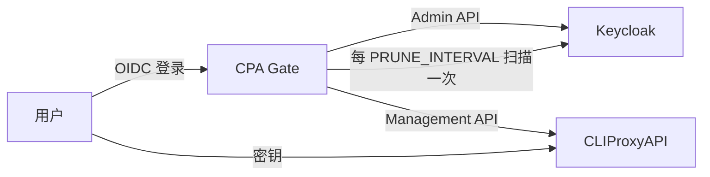

[English](./README.md) | [简体中文](#)

# CPA Gate

> [!WARNING]
> 本项目采用 **Vibe Coding** 方式开发。代码虽经人工审查，仍不能保证完全可控且无缺陷，
> 请在评估风险后使用。

面向 [CLIProxyAPI](https://github.com/router-for-me/CLIProxyAPI) 的轻量级、无数据库入口服务。

用户通过现有 SSO（OIDC，主要面向 Keycloak）登录后获得一枚个人 CLIProxyAPI 密钥。页面仅展示必要信息：

- 调用地址
- API 密钥（支持轮换）
- 快速配置（一键导入 Cherry Studio、Chatbox、OpenCat）
- 当前可用模型（点击模型名复制）

## 目录

- [工作原理](#工作原理)
- [快速开始](#快速开始)
- [配置](#配置)
  - [服务器](#服务器)
  - [站点品牌](#站点品牌)
  - [CLIProxyAPI](#cliproxyapi)
  - [页面上展示的地址](#页面上展示的地址)
  - [KeyCordon 隐私保护（可选）](#keycordon-隐私保护可选)
  - [OIDC](#oidc)
  - [Keycloak 登录客户端](#keycloak-登录客户端)
  - [Keycloak Admin API](#keycloak-admin-api)
  - [自动撤销](#自动撤销)
- [API](#api)
- [密钥格式](#密钥格式)
- [安全说明](#安全说明)
- [Docker](#docker)
- [开发](#开发)

## 工作原理

- **无数据库。** CLIProxyAPI 自身的客户端密钥列表（`/v0/management/api-keys`）是唯一数据源。
- **密钥自描述。** 每枚密钥的格式为 `<userId>.<random>`，无需映射表即可由密钥反查用户。
- **SSO 准入。** 发放密钥前，服务通过 Keycloak Admin API 确认该用户仍然存在、处于启用状态，且属于允许的用户组。
- **扫描式撤销。** 服务按固定间隔扫描全部受管密钥，删除已被删除、禁用或已离开允许组的用户所持有的密钥。



## 快速开始

环境要求：Node.js >= 20.19，pnpm >= 11。

```bash
pnpm install
cp .env.example .env
# 编辑 .env，至少填写 SESSION_SECRET 与 CPA_MANAGEMENT_*
pnpm dev
```

生产构建：

```bash
pnpm build
node dist/index.js
```

## 配置

### 服务器

| 变量 | 默认值 | 说明 |
| --- | --- | --- |
| `SERVER_HOST` | `0.0.0.0` | 监听地址 |
| `SERVER_PORT` | `3001` | 监听端口 |
| `ENV_PRODUCT` | `development` | 设为 `production` 时启用 Secure Cookie |
| `SESSION_SECRET` | — | **必填，不少于 32 字节。** 会话 JWT 的 HMAC 密钥；长度不足时启动即失败 |
| `SESSION_COOKIE_NAME` | `cpa_session` | 会话 Cookie 名称 |
| `SESSION_TTL` | `604800` | 会话有效期（秒） |

### 站点品牌

共六个可选变量，每种语言三个：

| 变量 | 默认值 | 说明 |
| --- | --- | --- |
| `SITE_TITLE_ZH_HANS` | `CPA Gate` | 浏览器标题、顶栏品牌名与页面主标题（简体中文） |
| `SITE_SUBTITLE_ZH_HANS` | `CLIProxyAPI` | 顶栏品牌名右侧的副标题（简体中文） |
| `SITE_DESCRIPTION_ZH_HANS` | 语言包 `tagline` | 页面副标题与 `<meta name="description">`（简体中文） |
| `SITE_TITLE_EN` | `CPA Gate` | 同上，英文界面 |
| `SITE_SUBTITLE_EN` | `CLIProxyAPI` | 同上，英文界面 |
| `SITE_DESCRIPTION_EN` | 语言包 `tagline` | 同上，英文界面 |

任一项留空时回退到该语言的默认文案，因此可只覆盖需要的字段：

```env
SITE_TITLE_ZH_HANS=知行 AI 网关
SITE_DESCRIPTION_ZH_HANS=登录后获取你的 CLIProxyAPI 密钥
SITE_TITLE_EN=ZhiXing AI Gateway
SITE_DESCRIPTION_EN=Sign in to get your CLIProxyAPI key
```

### CLIProxyAPI

| 变量 | 默认值 | 说明 |
| --- | --- | --- |
| `CPA_MANAGEMENT_URL` | — | **必填。** 管理 API 基址，不含 `/v0/management` |
| `CPA_MANAGEMENT_KEY` | — | **必填。** CLIProxyAPI 管理密钥 |
| `CPA_API_BASE_URL` | 管理地址 | 展示给用户的调用基址，仅用于展示；模型查询始终经由 `CPA_MANAGEMENT_URL` |
| `CPA_TIMEOUT_MS` | `10000` | 上游请求超时（毫秒） |
| `MODELS_CACHE_TTL` | `60` | 模型列表缓存时长（秒），`0` 表示不缓存 |

若 CPA Gate 与 CLIProxyAPI 不在同一主机，需在 CLIProxyAPI 中开启远程管理：

```yaml
remote-management:
  allow-remote: true
  secret-key: <management-key>
```

### 页面上展示的地址

CLIProxyAPI 在同一端口上提供多套兼容协议，页面会全部列出（每条均可点击复制）：

| 客户端 | 需设置的环境变量 | 默认展示的基址 | 打开「完整 URL」后展示的完整路径 |
| --- | --- | --- | --- |
| OpenAI SDK / Codex CLI（Chat Completions） | `OPENAI_BASE_URL` | `${CPA_API_BASE_URL}/v1` | `${CPA_API_BASE_URL}/v1/chat/completions` |
| Claude Code | `ANTHROPIC_BASE_URL` | `${CPA_API_BASE_URL}` | `${CPA_API_BASE_URL}/v1/messages` |
| Gemini CLI | `GOOGLE_GEMINI_BASE_URL` | `${CPA_API_BASE_URL}/v1beta` | `${CPA_API_BASE_URL}/v1beta/models/{model}:generateContent` |

第一条是主「调用地址」，其余列在其下方。该区块右上角的 **完整 URL** 开关（默认关闭）会把所有地址从「客户端环境变量应填的基址」切换为「可直接调用的完整接口路径」；选择保存在 `localStorage`，复制按钮始终复制当前显示的内容。Anthropic 一项**刻意不带** `/v1`：Claude Code 会自行追加 `/v1/messages`，若填成 `/v1` 便会变成 `/v1/v1/messages`。

### KeyCordon 隐私保护（可选）

[KeyCordon](https://gitlab.soraharu.com/XiaoXi/keycordon) 是面向 LLM API 的反向代理。请求离开本机前，它会把请求体中的 API 密钥、令牌、私钥与连接串密码替换为占位符；响应返回客户端前再还原。上游模型始终无法看到原始密钥。

启用后，页面「调用地址」区块右上角会新增 **KeyCordon 隐私保护** 开关（位于「完整 URL」左侧）。开关打开时，三条调用地址与「快速配置」的 Deep Link 全部切换为 KeyCordon 地址；关闭时恢复为直连地址。

| 变量 | 默认值 | 说明 |
| --- | --- | --- |
| `KEYCORDON_ENABLED` | `false` | 设为 `true` 时启用集成：`/api/portal` 下发 KeyCordon 地址，页面渲染开关 |
| `KEYCORDON_URL` | — | KeyCordon 的**外部访问地址**（客户端实际访问的地址），如 `https://kc.example.com`。启用时必填，仅用于展示，服务端不会连接该地址 |
| `KEYCORDON_DEFAULT_ON` | `false` | 开关的**初始**状态；用户手动切换后以浏览器 `localStorage` 为准 |

未启用集成时，`/api/portal` 完全不下发 `keycordon` 字段，页面与集成前保持一致。

`KEYCORDON_URL` 仅做格式校验（必须为 http/https），不会探测可达性，因此配置错误表现为「地址可复制但无法连接」。填写回环地址（`localhost` / `127.0.0.1`）时启动日志会给出告警，因为客户端无法访问服务端视角的回环地址。

#### 使用 `-keycordon` 镜像

`latest-keycordon` 标签在同一容器内同时运行 cpa-gate（3001）与 keycordon（8318），无需另行部署 keycordon：

```bash
docker run -d --name cpa-gate \
  -p 3001:3001 \
  -p 127.0.0.1:8318:8318 \
  -e CPA_MANAGEMENT_URL='http://cliproxyapi:8317' \
  -e CPA_MANAGEMENT_KEY='…' \
  -e SESSION_SECRET='…' \
  -e KEYCORDON_ENABLED=true \
  -e KEYCORDON_URL='https://kc.example.com' \
  -e KEYCORDON_MASTER_KEY="$(head -c 32 /dev/urandom | od -An -tx1 | tr -d ' \n')" \
  docker.io/yanranxiaoxi/cpa-gate:latest-keycordon
```

该镜像额外读取以下两个变量：

| 变量 | 默认值 | 说明 |
| --- | --- | --- |
| `KEYCORDON_UPSTREAM` | `$CPA_MANAGEMENT_URL` | 内置 keycordon 的上游地址（容器内可达地址） |
| `KEYCORDON_MASTER_KEY` | — | **必填**。主密钥，hex 或 base64 编码且不少于 32 字节；缺失时容器拒绝启动 |

注意区分 `KEYCORDON_URL`（外部地址，供浏览器使用）与 `KEYCORDON_UPSTREAM`（容器内地址，供 keycordon 使用）。

**更换主密钥会使全部历史占位符失效**，并导致上游重新计算一次 prompt cache。请将其作为长期机密保管。

#### 反向代理

8318 端口需由部署方自行暴露并配置证书（证书可选，由部署方负责）。反向代理必须满足以下两点：

1. **原样转发客户端凭据**：`Authorization`、`x-api-key`、`x-goog-api-key`、`?key=`、`?auth_token=`。keycordon 依据它们划分 vault；凭据丢失会导致不同客户端共用同一 vault，甲方的占位符可被乙方还原。
2. **关闭响应缓冲**：LLM 响应均为流式，nginx 的默认缓冲会让请求看起来处于挂起状态。

```nginx
server {
    listen 443 ssl;
    server_name kc.example.com;

    # keycordon 默认请求体上限为 8 MiB；nginx 默认仅 1 MB，会先触发 413
    client_max_body_size 16m;

    location / {
        proxy_pass http://127.0.0.1:8318;
        proxy_http_version 1.1;
        proxy_buffering off;
        proxy_set_header Host $host;
        # 以下三行为 nginx 默认值，显式写出以免被误删
        proxy_set_header Authorization $http_authorization;
        proxy_set_header X-Api-Key $http_x_api_key;
        proxy_set_header X-Goog-Api-Key $http_x_goog_api_key;
    }
}
```

Caddy 的默认行为即符合要求，只要不添加 `request_header -Authorization`：

```text
kc.example.com {
    reverse_proxy 127.0.0.1:8318
}
```

**防滥用由部署方负责**：8318 是新增的公网入口，请在反向代理层配置速率与并发限制。

#### 灰度与排障

- 需要先观察再启用时：挂载自定义配置覆盖 `/etc/keycordon/config.yaml`，将 `mode` 设为 `observe`（仅记录命中，不做改写），确认无误报后再改回 `enforce`。
- 需要回退时：将 `KEYCORDON_DEFAULT_ON` 设为 `false`，用户回到直连地址，keycordon 继续保留日志。
- 请求体超过 8 MiB（例如单次请求携带多张图片）会返回 413 且**不会透传**；如需放宽，挂载配置调大 `limits.max_body_bytes`，并注意内存约为「并发数 × `max_decoded_bytes`」。
- 健康检查：`curl http://127.0.0.1:8318/_keycordon/healthz` 返回版本、模式与主密钥指纹（免鉴权）。
- 任一进程退出时容器整体退出（fail fast），避免出现「开关显示已启用但实际未生效」的状态。

### OIDC

| 变量 | 默认值 | 说明 |
| --- | --- | --- |
| `OIDC_ISSUER` | — | 例如 `https://sso.example.com/realms/main` |
| `OIDC_CLIENT_ID` | — | OIDC Client ID |
| `OIDC_CLIENT_SECRET` | — | OIDC Client Secret |
| `OIDC_REDIRECT_URI` | — | 例如 `https://cpa-gate.example.com/api/auth/callback` |
| `OIDC_SCOPE` | `openid profile email` | 请求 scope |
| `OIDC_USERNAME_CLAIM` | `preferred_username` | 页面显示的用户名 |
| `OIDC_USER_ID_CLAIM` | `sub` | 作为 Key 前缀的 claim（必须是 Keycloak 真实用户 ID） |
| `OIDC_PROVIDER_NAME` | 空 | 登录按钮上的文案 |
| `OIDC_ACCOUNT_URL` | 空 | 可选用户中心链接（仅 http/https） |
| `OIDC_POST_LOGOUT_REDIRECT_URI` | 站点根 | RP-initiated logout 回跳地址 |
| `OIDC_ALLOW_INSECURE` | `false` | 仅本地测试：允许 `http://` issuer |

### Keycloak 登录客户端

登录客户端与下文的管理客户端是两个独立的 Client：

1. **Clients → Create client**
   - Client type：`OpenID Connect`
   - Client ID：`cpa-gate`（即 `OIDC_CLIENT_ID`）
2. **Capability config**
   - Client authentication：**On**（机密客户端，Secret 在 Credentials 页复制为 `OIDC_CLIENT_SECRET`）
   - Standard flow：**On**（授权码 + PKCE S256）
   - Implicit flow / Direct access grants / Service accounts roles：全部 **Off**
3. **Settings → Valid redirect URIs**：必须与 `OIDC_REDIRECT_URI` **完全一致**。

   ```
   https://cpa-gate.example.com/api/auth/callback
   ```

   本地开发可额外添加：`http://localhost:3001/api/auth/callback`。
4. **Settings → Valid post logout redirect URIs**：RP-initiated logout 的回跳地址，即站点根。

   ```
   https://cpa-gate.example.com/
   ```

   「同时退出 SSO 系统」按钮会返回该地址；未显式配置 `OIDC_POST_LOGOUT_REDIRECT_URI` 时，服务自动取 `OIDC_REDIRECT_URI` 的站点根。
5. **Settings → Advanced → Subject Type**：`public`。若设为 `pairwise`，`sub` 为每个客户端各不相同的匿名标识，既不能作为密钥前缀，也无法用于 Admin API 查询。
6. **Web origins**：可留空（所有请求均经本服务同源转发）。

对应关系：

| Keycloak 字段 | 值 |
| --- | --- |
| Valid redirect URI | `${OIDC_PUBLIC_ORIGIN}/api/auth/callback` |
| Valid post logout redirect URI | `${OIDC_PUBLIC_ORIGIN}/` |

若 CPA Gate 部署在带路径前缀的反向代理之后（如 `https://example.com/cpa-gate/`），回调应为 `https://example.com/cpa-gate/api/auth/callback`，且代理必须原样转发该路径。

### Keycloak Admin API

`KEYCLOAK_ADMIN_CLIENT_ID` 与 `KEYCLOAK_ADMIN_CLIENT_SECRET` 来自**另一个**专供 Admin REST 使用的机密客户端（confidential client），仅需创建一次：

1. **Clients → Create client**
   - Client type：`OpenID Connect`
   - Client ID：`cpa-gate-admin`（名称可自定义，即 `KEYCLOAK_ADMIN_CLIENT_ID`）
2. **Capability config**
   - Client authentication：**On**
   - Authorization：Off
   - Standard flow / Implicit flow / Direct access grants：全部 **Off**
   - Service accounts roles：**On**
3. 保存后打开 **Credentials** 标签页，复制 **Client secret** 填入 `KEYCLOAK_ADMIN_CLIENT_SECRET`。
4. 打开 **Service accounts roles** 标签页 → **Assign role** → 按客户端 `realm-management` 筛选 → 勾选：
   - `view-users`（读取用户资料、启用状态、用户名与邮箱）
   - `query-groups`（列出用户所属组）
5. **Keycloak 26.8.2 及以上：分配 `kc-admin-api` client scope**（遗漏将导致登录失败）
   - **Client scopes** 标签页 → **Add client scope** → 勾选 `kc-admin-api` → **Add** → 选择 **Default**
   - 原因：自 26.8.2 起（CVE-2026-19688）Admin REST API 强制校验 token 的 audience，token 必须携带 `kc-admin-api` scope；升级时 Keycloak 仅为内置客户端（`admin-cli`、`security-admin-console`）自动分配，自建服务账号需手动添加
   - 症状：页面显示「暂时无法验证账号状态」，日志出现 `GET /users/… returned 401`；本服务会在该日志中附带 `www-authenticate` 并提示该 scope
6. 使用 curl 验证凭据：

```bash
curl -s -X POST \
  "$OIDC_ORIGIN/realms/$REALM/protocol/openid-connect/token" \
  -d grant_type=client_credentials \
  -d client_id=cpa-gate-admin \
  -d client_secret='…'
```

返回体中出现 `access_token` 说明凭据正确。随后验证权限：

```bash
curl -s -H "Authorization: Bearer $TOKEN" \
  "$OIDC_ORIGIN/admin/realms/$REALM/users/$USER_UUID"
curl -s -H "Authorization: Bearer $TOKEN" \
  "$OIDC_ORIGIN/admin/realms/$REALM/users/$USER_UUID/groups"
```

两条请求均返回 `200` 才说明角色足够。若此处返回 `403`，服务会拒绝登录（`?login=unavailable`），清理时也会保留相应密钥。

若刚签发的 token 返回 `401` 而非 `403`，通常是第 5 步的 `kc-admin-api` scope 未分配（Keycloak 26.8.2+）。

> 请勿授予 `realm-admin`，也不要复用 `OIDC_CLIENT_ID` / `OIDC_CLIENT_SECRET`：登录客户端必须保持 public 且不含管理角色，管理客户端则不应开启任何浏览器流程。

| 变量 | 默认值 | 说明 |
| --- | --- | --- |
| `ALLOWED_GROUPS` | — | 逗号分隔或 JSON 数组；支持组名（`ai`）或路径（`/staff/ai`） |
| `ALLOWED_USERS` | — | 逗号分隔或 JSON 数组；指定具体用户：UUID、用户名或邮箱 |
| `KEYCLOAK_ADMIN_BASE_URL` | 从 issuer 推导 | 例如 `https://sso.example.com` |
| `KEYCLOAK_REALM` | 从 issuer 推导 | 例如 `main` |
| `KEYCLOAK_ADMIN_CLIENT_ID` | — | 服务账号 Client ID |
| `KEYCLOAK_ADMIN_CLIENT_SECRET` | — | 服务账号 Secret |
| `KEYCLOAK_ADMIN_TIMEOUT_MS` | `10000` | Admin API 超时 |

服务账号需要 `realm-management` 角色：`view-users`、`query-groups`。

组匹配会沿祖先路径判断：属于 `/staff/ai/llm` 的用户命中 `/staff/ai`；仅属于 `/staff/ai` 的用户**不**命中 `/staff/ai/llm`。

`ALLOWED_GROUPS` 与 `ALLOWED_USERS` 取**并集**，命中任意一项即可；启用登录时两者至少配置一项。

`ALLOWED_USERS` 大小写不敏感，裸值会同时匹配用户的 UUID、用户名与邮箱；也可使用 `uuid:`、`username:`、`email:` 前缀限定只匹配某个字段：

```env
ALLOWED_GROUPS=/staff/ai
ALLOWED_USERS=0f8fad5b-d9cb-469f-a165-70867728950e,email:contractor@example.com,username:guest-dev
```

说明：登录被拒时，页面会显示该用户自身的 UUID 并提供复制按钮，用户可将其发送给管理员加入名单；已登录用户失去资格时同样显示该 ID。

### 自动撤销

| 变量 | 默认值 | 说明 |
| --- | --- | --- |
| `PRUNE_INTERVAL` | `1800` | 两次扫描之间的间隔（秒）；`0` 表示完全关闭扫描 |

服务按该间隔扫描全部受管密钥，删除已被删除、禁用或已离开允许组的用户所持有的密钥。登录仅控制新密钥的发放，撤销完全依赖该扫描，因此撤销会在一个间隔内生效。

每轮扫描输出一行摘要：

```text
[prune] scanned=12 managed=10 valid=9 removed=1 errors=0
```

Keycloak 异常（超时、5xx、401/403）时，扫描会**保留**受影响用户的密钥，并额外输出一行错误日志。静默跳过用户等同于在无提示的情况下关闭撤销能力：

```text
[prune] 2 user(s) could not be verified, their keys were kept: [{"userId":"…","reason":"keycloak_unavailable"}]
```

建议对第二行配置告警。该机制不依赖额外端点，也无需外部 cron。

## API

| 方法 | 路径 | 鉴权 | 用途 |
| --- | --- | --- | --- |
| `GET` | `/api/config` | — | 公共配置（调用地址与站点文案） |
| `GET` | `/api/auth/status` | — | 会话状态 |
| `GET` | `/api/auth/login` | — | 跳转身份提供方 |
| `GET` | `/api/auth/callback` | — | OIDC 回调 |
| `GET` | `/api/auth/logout` | — | 退出登录；`?sso=1` 同时结束身份提供方会话。仅接受同源请求 |
| `GET` | `/api/portal` | 会话 | 调用地址、API 密钥、可用模型 |
| `POST` | `/api/token/rotate` | 会话 | 轮换 API 密钥 |

## 密钥格式

```text
<userId>.<32 字节 base64url>
```

仅匹配 `^([\w-]{1,128})\.([\w-]{43})$` 的密钥由本服务管理；其余密钥在轮换与清理时原样保留。

## 安全说明

- CLIProxyAPI 管理密钥与 SSO 密钥永不下发至浏览器。
- 密钥仅通过已认证的 `no-store` 响应返回，日志中脱敏。
- Keycloak 不可用时，登录 fail closed，清理 fail safe（保留密钥）。
- 被清理的用户刷新页面无法重新获得密钥：`/api/portal` 在补发前会重新校验 Keycloak。
- 轮换与登出接口仅接受同源请求，避免被跨站强制触发。
- 登录被拒时仅展示用户自身的 UUID，暂存于 5 分钟有效的签名 Cookie 中（重新登录或登录成功时清除），不写入 URL。
- 所有响应附带严格 CSP 等安全头；容器以非 root 用户运行。

## Docker

已发布镜像：[`docker.io/yanranxiaoxi/cpa-gate`](https://hub.docker.com/r/yanranxiaoxi/cpa-gate)，其中 `latest` 跟随默认分支。

两个标签：

| 标签 | 内容 |
| --- | --- |
| `latest` | 仅含 cpa-gate，监听 3001 |
| `latest-keycordon` | cpa-gate 与 keycordon，监听 3001 与 8318（见 [KeyCordon 隐私保护](#keycordon-隐私保护可选)） |

容器以非 root 的 `node` 用户运行，仅 `./logs` 可写；如需持久化日志，挂载该目录。

```bash
docker run -d --name cpa-gate \
  -p 3001:3001 \
  -e CPA_MANAGEMENT_URL='http://cliproxyapi:8317' \
  -e CPA_MANAGEMENT_KEY='…' \
  -e OIDC_ISSUER='https://sso.example.com/realms/main' \
  -e OIDC_CLIENT_ID='cpa-gate' \
  -e OIDC_CLIENT_SECRET='…' \
  -e OIDC_REDIRECT_URI='https://cpa-gate.example.com/api/auth/callback' \
  -e ALLOWED_GROUPS='/staff/ai' \
  -e KEYCLOAK_ADMIN_CLIENT_ID='cpa-gate-admin' \
  -e KEYCLOAK_ADMIN_CLIENT_SECRET='…' \
  -e SESSION_SECRET='…' \
  -e PRUNE_INTERVAL=1800 \
  docker.io/yanranxiaoxi/cpa-gate:latest
```

如需本地构建并使用自定义标签：

```bash
pnpm build
docker build -t cpa-gate .
docker run -d --name cpa-gate -p 3001:3001 \
  -e CPA_MANAGEMENT_KEY='…' \
  -e SESSION_SECRET='…' \
  cpa-gate
```

镜像同时发布在 GitLab 私有仓库：`registry.gitlab.soraharu.com/xiaoxi/cpa-gate:latest`。镜像内执行 `pnpm install --prod` 并复制 `dist/`（后端 + `public/`）。`CPA_MANAGEMENT_URL` 默认值为 `http://127.0.0.1:8317`，CLIProxyAPI 位于其它容器时需覆盖。

`-keycordon` 镜像的构建方式：CI 从 [keycordon 软件包仓库](https://gitlab.soraharu.com/XiaoXi/keycordon/-/packages) 获取最新的发布版本（排除 `nightly`）的 `linux_amd64` 静态二进制并打入镜像。因此该镜像**不可复现**，每次构建可能携带不同的 keycordon 版本；排查时可通过 `docker inspect` 查看 `org.opencontainers.image.keycordon.version` 标签。本地构建需先手动下载二进制：

```bash
curl -fL -o keycordon-integration/keycordon-linux-amd64 \
  "https://gitlab.soraharu.com/api/v4/projects/168/packages/generic/keycordon/<版本>/keycordon_<版本>_linux_amd64"
chmod 0755 keycordon-integration/keycordon-linux-amd64
pnpm build
docker build -f Dockerfile.keycordon --build-arg KEYCORDON_VERSION=<版本> -t cpa-gate:keycordon .
```

## 开发

```bash
pnpm dev        # 后端与前端 watch
pnpm typecheck  # 类型检查
pnpm lint       # 代码检查
pnpm build      # 生产构建
```

页面、SSO 流程、主题、i18n 与构建流程与 `LibreTranslate-FrontPage`、`pingatlas` 保持一致，以保证三个服务的风格统一。

完整设计见 [SPECS.md](./SPECS.md)。
