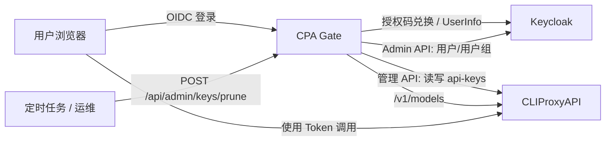
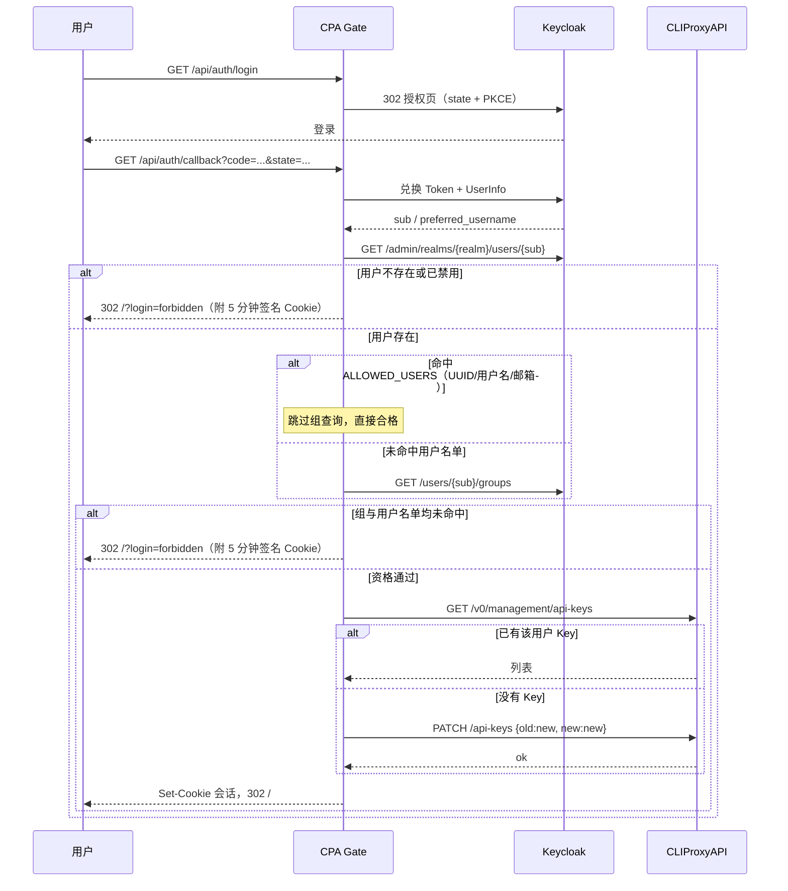

# CPA Gate 规格说明

> 版本：v1.0（已实现）  
> 目标读者：本项目的实现者与运维者  
> 关联项目：`LibreTranslate-FrontPage`、`pingatlas`（共享框架、SSO 流程与页面风格）

---

## 1. 项目概述

CPA Gate 是一个面向 [CLIProxyAPI](https://github.com/router-for-me/CLIProxyAPI) 的轻量级入口服务：

- 用户通过现有 SSO（OIDC，主要面向 Keycloak）登录。
- 登录成功后，服务为用户在 CLIProxyAPI 中创建一枚个人 API Key。
- 用户在页面上查看：
  - CLIProxyAPI 调用地址
  - 个人 Token（支持轮换）
  - 当前可用的模型列表
- 服务不引入数据库。所有 Key 状态都存放在 CLIProxyAPI 的客户端认证 Key 列表中。
- 提供一个由环境变量 Key 鉴权的管理接口，用于扫描并清理已经失效的用户 Key。

### 1.1 设计原则

1. **无数据库**：CPA Gate 本身不持久化业务数据，重启不丢失用户 Key。
2. **Key 自描述**：Key 以用户 ID 开头，可从 Key 本身反查用户，无需映射表。
3. **最小暴露**：管理 Key、CLIProxyAPI 管理 Key、Keycloak 管理员凭据只存在于服务端环境变量中。
4. **与兄弟项目一致**：页面结构、主题、登录/登出弹窗、i18n、静态资源构建方式尽量直接复用。
5. **失败安全**：
   - 登录阶段无法确认用户资格时拒绝登录（fail closed）。
   - 清理阶段无法确认用户状态时保留 Key（fail safe）。

### 1.2 不在本期范围

- 用户额度、调用量统计、账单
- 按用户限制模型
- 管理后台页面
- 多租户 / 多 Keycloak Realm
- 数据库、Redis、消息队列
- 用户自助删除账号

---

## 2. 调研结论

### 2.1 CLIProxyAPI 管理 API

CLIProxyAPI 当前同时提供 v0 与 v8 管理 API。本项目使用稳定的 v0 客户端 Key 管理接口。

**鉴权**

管理接口使用 CLIProxyAPI 的 Management Key：

```http
Authorization: Bearer <CPA_MANAGEMENT_KEY>
```

或：

```http
X-Management-Key: <CPA_MANAGEMENT_KEY>
```

> 如果 CPA Gate 与 CLIProxyAPI 不在同一台主机（或不在同一个 loopback 网络），CLIProxyAPI 必须开启远程管理：
>
> ```yaml
> remote-management:
>   allow-remote: true
>   secret-key: <management-key>
> ```
>
> 否则远程请求会返回 `403 remote management disabled`。即使在本机，管理 Key 也必须配置。

**客户端 API Key 接口**

基址：`{CPA_MANAGEMENT_URL}/v0/management`

| 方法 | 路径 | 说明 |
| --- | --- | --- |
| `GET` | `/api-keys` | 读取客户端 Key 列表，返回 `{"api-keys": ["key1", "key2"]}` |
| `PUT` | `/api-keys` | 整体替换 Key 列表（**会覆盖其他来源的 Key，本项目禁用**） |
| `PATCH` | `/api-keys` | 按 `{ "old": "...", "new": "..." }` 替换；`old` 不存在时追加 `new` |
| `DELETE` | `/api-keys?value=<urlencoded-key>` | 按值删除；也支持 `?index=<n>` |

**关键结论**

- 可以实现无数据库的 Key 管理：Key 列表本身就是唯一数据源。
- 使用 `PATCH` 而不是 `PUT`，避免覆盖用户通过其它方式添加的 Key。
- **幂等新增**技巧：发送 `{"old": "<new-key>", "new": "<new-key>"}`。
  - Key 已存在：替换为自身，无副作用。
  - Key 不存在：追加。
- `DELETE ?value=` 天然幂等，适合轮换和清理。
- 管理 API 保存配置后会异步触发 CLIProxyAPI 重新加载。刚创建的 Key 可能存在极短的生效延迟，模型查询应做一次短重试。

**模型列表**

CLIProxyAPI 的 `/v1/models` 需要客户端 API Key：

```http
GET {CPA_API_BASE_URL}/v1/models
Authorization: Bearer <user-api-key>
```

返回 OpenAI 兼容结构：

```json
{
  "object": "list",
  "data": [
    { "id": "gpt-5", "object": "model" },
    { "id": "claude-sonnet-4", "object": "model" }
  ]
}
```

> 不使用管理 Key 查询模型，因为 `/v1/models` 走的是客户端 Key 鉴权；用用户自己的 Key 查询还能保证展示的是该 Key 当前实际可用的模型。

### 2.2 Keycloak 用户与用户组查询

**结论：可以。** Keycloak Admin REST API 支持按用户 ID 查询用户是否存在，以及查询用户所属用户组，不需要本地数据库。

推荐使用独立的服务账号（Service Account）调用 Admin API。

**获取管理员 Token**

```http
POST {KEYCLOAK_ADMIN_BASE_URL}/realms/{realm}/protocol/openid-connect/token
Content-Type: application/x-www-form-urlencoded

grant_type=client_credentials
&client_id={KEYCLOAK_ADMIN_CLIENT_ID}
&client_secret={KEYCLOAK_ADMIN_CLIENT_SECRET}
```

**查询用户是否存在 / 是否启用**

```http
GET {KEYCLOAK_ADMIN_BASE_URL}/admin/realms/{realm}/users/{userId}
Authorization: Bearer <admin-access-token>
```

- `200`：用户存在，响应中的 `enabled` 表示是否启用。
- `404`：用户已删除。

**查询用户所属组**

```http
GET {KEYCLOAK_ADMIN_BASE_URL}/admin/realms/{realm}/users/{userId}/groups?briefRepresentation=false&first=0&max=500
Authorization: Bearer <admin-access-token>
```

返回 `GroupRepresentation[]`，每项至少包含：

```json
{
  "id": "...",
  "name": "ai",
  "path": "/staff/ai"
}
```

**服务账号需要的 Realm Management 角色**

在 Keycloak 中给该 Client 的 Service Account 分配：

- `view-users`
- `query-groups`

这两个角色足以读取用户资料（含 `enabled` / `username` / `email`）与用户所属组。不要授予 `realm-admin`。

**重要注意事项**

1. **用户 ID 必须使用 Keycloak 的真实用户 ID。**
   - 默认取 ID Token / UserInfo 的 `sub`。
   - Keycloak 默认 Subject Type 为 `public`，此时 `sub` 就是用户 UUID。
   - 如果 Client 配置了 `pairwise` Subject Type，`sub` 是成对匿名标识，**不能**用于 Admin API 查询。此时必须把 Client 改为 `public`，或额外通过用户名解析真实用户 ID 后再写入 Key。
   - 规格默认：`OIDC_USER_ID_CLAIM=sub`，并要求 Keycloak Client 使用 public subject type。

2. **用户组接口返回的是直接成员关系。**
   - 用户直接属于 `/staff/ai/llm` 时，接口返回该组，不一定返回父组 `/staff/ai`。
   - 本项目通过 `path` 向上拆分祖先路径来判断父组配置是否命中：
     - 用户组：`/staff/ai/llm`
     - 候选：`/staff/ai/llm`、`/staff/ai`、`/staff`
     - 配置 `ALLOWED_GROUPS=/staff/ai` 时命中。
   - 反向不成立：配置子组 `/staff/ai/llm` 不会让只属于父组 `/staff/ai` 的用户通过。

3. **分组结果需要分页。** 使用 `first` / `max` 循环拉取，直到返回数量小于 `max`；同时设置上限（例如 2000 个组）防止异常数据拖垮服务。

4. **禁用用户按不合格处理。** `enabled === false` 时拒绝登录，并在清理时移除其 Key。

5. **具体用户名单。** `GET /users/{id}` 的响应同时包含 `username` 与 `email`，因此清理时仅凭 Key 前缀里的 UUID 也能匹配按用户名/邮箱配置的白名单，不需要额外接口。

6. **如何获得用户 UUID。** Keycloak 控制台的用户详情页地址栏里就是 UUID；本服务在登录被拒时也会在页面上直接显示当前用户自己的 UUID（不写入 URL，见 6.1）。

---

## 3. 总体架构



### 3.1 运行形态

- 单个 Node.js 进程，使用项目自带 Venation 框架。
- 无数据库、无持久化卷（日志除外）。
- 会话使用 HMAC-SHA256 签名的无状态 JWT，存放在 HttpOnly Cookie 中。
- 用户 Key 的唯一事实来源是 CLIProxyAPI 的 `api-keys` 列表。
- 允许部署多个副本，但轮换/清理操作需要依赖 CLIProxyAPI 的原子接口；进程内互斥只能防止单副本并发。

---

## 4. 环境变量

### 4.1 服务

| 变量 | 必填 | 默认值 | 说明 |
| --- | --- | --- | --- |
| `ENV_PRODUCT` | 否 | `development` | `production` / `true` / `1` 时启用 Secure Cookie |
| `SERVER_HOST` | 否 | `0.0.0.0` | 监听地址 |
| `SERVER_PORT` | 否 | `3001` | 监听端口 |
| `SERVER_NAME` | 否 | `cpa-gate` | 服务名 |
| `PROJECT_NAME` | 否 | `cpa-gate` | 项目名 |
| `LOG_LEVEL` | 否 | `info` | winston 日志级别 |
| `STATIC_DIR` | 否 | 自动解析 | 前端静态资源目录 |
| `SITE_TITLE_ZH_HANS` / `SITE_TITLE_EN` | 否 | 语言包 `appName` | 对应语言的浏览器标题、顶栏品牌名、页面主标题 |
| `SITE_SUBTITLE_ZH_HANS` / `SITE_SUBTITLE_EN` | 否 | 语言包 `brandSub` | 对应语言的顶栏品牌副标题 |
| `SITE_DESCRIPTION_ZH_HANS` / `SITE_DESCRIPTION_EN` | 否 | 语言包 `tagline` | 对应语言的页面副标题与 meta description |

### 4.2 CLIProxyAPI

| 变量 | 必填 | 默认值 | 说明 |
| --- | --- | --- | --- |
| `CPA_MANAGEMENT_URL` | 是 | — | 管理 API 基址，例如 `http://cliproxyapi:8317`。只写 origin + 可选 base path，不含 `/v0/management` |
| `CPA_MANAGEMENT_KEY` | 是 | — | CLIProxyAPI Management Key |
| `CPA_API_BASE_URL` | 否 | `CPA_MANAGEMENT_URL` | 前端展示的调用基址，也是 `/v1/models` 的请求基址。页面展示 `${CPA_API_BASE_URL}/v1` |
| `CPA_TIMEOUT_MS` | 否 | `10000` | 调用 CLIProxyAPI 的超时 |
| `MODELS_CACHE_TTL` | 否 | `60` | 模型列表缓存秒数，`0` 表示不缓存 |

示例：

```env
# 管理地址是内网地址
CPA_MANAGEMENT_URL=http://cliproxyapi:8317
CPA_MANAGEMENT_KEY=change-me

# 用户实际调用的公网地址；不配置则与管理地址一致
CPA_API_BASE_URL=https://cpa.example.com
```

### 4.3 OIDC 登录

与兄弟项目保持一致：

| 变量 | 必填 | 默认值 | 说明 |
| --- | --- | --- | --- |
| `OIDC_ISSUER` | 是 | — | 例如 `https://sso.example.com/realms/main` |
| `OIDC_CLIENT_ID` | 是 | — | OIDC Client ID |
| `OIDC_CLIENT_SECRET` | 是 | — | OIDC Client Secret |
| `OIDC_REDIRECT_URI` | 是 | — | 例如 `https://cpa-gate.example.com/api/auth/callback` |
| `OIDC_SCOPE` | 否 | `openid profile email` | 请求 scope |
| `OIDC_USERNAME_CLAIM` | 否 | `preferred_username` | 页面显示的用户名 |
| `OIDC_USER_ID_CLAIM` | 否 | `sub` | 写入 Key 的用户 ID，必须是 Keycloak 真实用户 UUID |
| `OIDC_PROVIDER_NAME` | 否 | 空 | 登录按钮上的 SSO 名称 |
| `OIDC_ACCOUNT_URL` | 否 | 空 | 用户中心地址，仅接受 http/https |
| `OIDC_POST_LOGOUT_REDIRECT_URI` | 否 | 自动取 `OIDC_REDIRECT_URI` 的站点根 | RP-initiated logout 回跳地址 |
| `OIDC_ALLOW_INSECURE` | 否 | `false` | 仅本地开发/测试：允许 `http://` issuer |

### 4.4 Keycloak Admin API

| 变量 | 必填 | 默认值 | 说明 |
| --- | --- | --- | --- |
| `ALLOWED_GROUPS` | 否 | — | 允许的用户组，逗号分隔或 JSON 数组；支持组名（`ai`）或完整路径（`/staff/ai`） |
| `ALLOWED_USERS` | 否 | — | 允许的具体用户，逗号分隔或 JSON 数组；裸值匹配 UUID/用户名/邮箱，可用 `uuid:`、`username:`、`email:` 限定字段 |
| `KEYCLOAK_ADMIN_BASE_URL` | 否 | 从 `OIDC_ISSUER` 取 origin | 例如 `https://sso.example.com` |
| `KEYCLOAK_REALM` | 否 | 从 `OIDC_ISSUER` 路径解析 | 例如 `main` |
| `KEYCLOAK_ADMIN_CLIENT_ID` | 是 | — | 用于 client_credentials 的 Client ID |
| `KEYCLOAK_ADMIN_CLIENT_SECRET` | 是 | — | 对应 Client Secret |
| `KEYCLOAK_ADMIN_TIMEOUT_MS` | 否 | `10000` | Admin API 超时 |

`ALLOWED_GROUPS` 与 `ALLOWED_USERS` 都支持两种写法：

- 逗号分隔（自动 trim、忽略空项）：`/staff/ai,devops`
- JSON 数组（值本身含逗号时使用）：`["/staff/ai","devops"]`

```env
ALLOWED_GROUPS=/staff/ai,devops
# 或
ALLOWED_GROUPS=["/staff/ai","devops"]

# 具体用户：UUID、用户名、邮箱；与组取并集
ALLOWED_USERS=0f8fad5b-d9cb-469f-a165-70867728950e,email:contractor@example.com,username:guest-dev
```

**匹配规则**

- 组与用户取**并集**：命中任意一项即合格。
- 用户条目大小写不敏感；裸值同时匹配 UUID、用户名、邮箱。
- `uuid:` / `username:` / `email:` 前缀把匹配限定到单一字段，适合避免“邮箱恰好等于某人的用户名”这类歧义。
- 允许列表为空时，无法发放任何 Key。

启动时校验：如果 OIDC 已启用但 Keycloak Admin 配置不完整，或两个名单都为空，直接抛错退出，避免出现“能登录但永远拿不到 Key”的隐性故障。

### 4.5 清理接口

| 变量 | 必填 | 默认值 | 说明 |
| --- | --- | --- | --- |
| `PRUNE_API_KEY` | 否 | 空 | 为空时清理接口返回 404（视为未启用） |

### 4.6 会话

| 变量 | 必填 | 默认值 | 说明 |
| --- | --- | --- | --- |
| `SESSION_SECRET` | 是 | — | 至少 32 字节随机值 |
| `SESSION_COOKIE_NAME` | 否 | `cpa_session` | 会话 Cookie 名 |
| `SESSION_TTL` | 否 | `604800` | 有效期（秒） |

---

## 5. 用户身份与 Key 设计

### 5.1 用户身份

- 登录使用 OIDC 授权码流 + S256 PKCE，复用兄弟项目的 `openid-client` 实现。
- 会话中保存：
  - `sub`：Keycloak 用户 ID（同时作为 Key 前缀）
  - `username`：页面显示名
- 不在会话中保存用户组：组关系可能随时变化，每次登录与清理时实时查询 Keycloak。

### 5.2 Key 格式

```text
<userId>.<random>
```

例如：

```text
0f8fad5b-d9cb-469f-a165-70867728950e.31icr8oXlTYOglN73ZI8YSaKZCl98MuH6WcJ8tz587I
```

规则：

- `userId`：来自 `OIDC_USER_ID_CLAIM`，默认 `sub`。
- 分隔符：英文句点 `.`。
- `random`：32 字节随机数，base64url 编码（43 个字符，字符集 `A-Z a-z 0-9 - _`）。
- `userId` 必须匹配 `^[A-Za-z0-9_-]{1,128}$`，且不能包含 `.`。
  - 不满足时拒绝登录并记录错误，避免 Key 无法解析。
- 由本服务创建的 Key 必须匹配：

```regex
^([A-Za-z0-9_-]{1,128})\.([A-Za-z0-9_-]{43})$
```

不匹配的 Key 视为“非本服务管理”，清理接口绝不能删除。

### 5.3 为什么可以无数据库

- 给定用户 ID，查找 Key：扫描 CLIProxyAPI Key 列表，取 `startsWith("<userId>.")` 的项。
- 给定 Key，反查用户：取第一个 `.` 之前的部分。
- 轮换：新增新 Key，删除同前缀旧 Key。
- 清理：遍历 Key 列表，对每个用户 ID 查询 Keycloak。

---

## 6. 功能流程

### 6.1 登录与首次发 Key



**规则**

1. 只有通过 Keycloak 用户状态校验，且命中 `ALLOWED_GROUPS` 或 `ALLOWED_USERS` 之一的用户才会建立会话。
2. Key 创建失败不应阻止登录：会话仍然建立，页面展示错误并允许重试。
3. Key 创建必须幂等，回调重复执行不会产生多枚 Key。
4. 登录失败标记：
   - `?login=failed`：OIDC 流程失败
   - `?login=forbidden`：用户不存在、已禁用，或组与用户名单均未命中
   - `?login=unavailable`：Keycloak 管理员接口不可用，无法完成校验
5. 被拒时如果已经拿到用户身份，服务端额外写入 `cpa_login_denied` 签名 Cookie（5 分钟、HttpOnly），内容为 `userId` / `username` / `reason`。`GET /api/auth/status` 只在未登录时读取它并在响应的 `denied` 字段返回；Cookie 保留到过期，期间刷新页面仍可看到，重新发起登录或登录成功时清除。
6. 前端优先用 `denied` 渲染“登录未获授权”卡片：说明原因、展示**用户自己的 UUID** 并提供复制按钮与重新登录按钮。UUID 不写入 URL，避免进入历史记录或 Referer。
7. 没有 `denied`（例如 Cookie 丢失、流程早期失败）时，退回按 `?login=` 标记弹 Toast，然后清理 URL 查询参数。

### 6.2 页面初始化

1. 加载 i18n、主题、`GET /api/config`。
2. 加载 `GET /api/auth/status`，渲染右上角用户区。
3. 已登录时请求 `GET /api/portal`。
4. 服务端在 `/api/portal` 中查找当前用户的 Key：
   - 已存在：直接返回第一枚，不重复查询 Keycloak。
   - 不存在：**先重新校验 Keycloak 资格**，合格才创建；不合格返回 `eligible:false`，不创建；Keycloak 不可用返回 `tokenError`，不创建。
   - 该规则确保“已被清理的用户”不能靠刷新页面重新拿到 Key。
5. 服务端查询模型列表并返回。

### 6.3 Token 轮换

```http
POST /api/token/rotate
Cookie: cpa_session=...
```

流程：

1. 校验会话。
2. 重新查询 Keycloak 资格；不合格返回 `403 not_eligible`，不生成新 Key。
3. 生成新 Key：`<userId>.<new-random>`。
4. 调用 `PATCH /v0/management/api-keys`，请求体 `{ "old": "<new-key>", "new": "<new-key>" }`，确保新 Key 存在。
5. 重新读取 Key 列表，删除所有同 `userId.` 前缀且不等于新 Key 的 Key。
6. 返回新 Key。

**顺序要求：先加新、后删旧。** 如果第 3 步失败，不得删除旧 Key。  
如果第 4 步部分失败，返回错误但新 Key 已可用；运维可再次执行清理或轮换。

### 6.4 清理接口

```http
POST /api/admin/keys/prune
X-Admin-Key: <PRUNE_API_KEY>
```

可选：

```http
POST /api/admin/keys/prune?dryRun=true
```

流程：

1. 校验管理员 Key（常量时间比较）。
2. 获取 CLIProxyAPI Key 列表。
3. 仅处理匹配第 5.2 节格式的 Key；其它 Key 原样保留。
4. 按 `userId` 去重，避免同一用户重复查询 Keycloak。
5. 对每个用户：
   - `GET /users/{userId}`：
     - `404` → 删除该用户所有受管 Key。
     - `enabled === false` → 删除。
   - 命中 `ALLOWED_USERS`（用 `GET /users/{id}` 返回的 `username` / `email` 匹配）→ 保留，不再查组。
   - 否则 `GET /users/{userId}/groups`：
     - 与 `ALLOWED_GROUPS` 无交集 → 删除（`not_allowed`）。
     - 有交集 → 保留。
   - 未配置任何组时跳过组查询，直接按 `not_allowed` 处理。
   - Keycloak 请求失败（超时、5xx、管理员 Token 获取失败、`401`/`403` 权限不足）→ **保留**，记录错误。
   - 只有 `GET /users/{id}` 明确返回 `404`，或用户组接口成功返回 `200` 且确实无交集时，才删除 Key。
   - `403` 绝不能解释为“用户不在组”，否则服务账号权限配置错误会导致批量误删。
6. `dryRun=true` 时只统计“将删除”，不实际删除。
7. 删除使用 `DELETE /v0/management/api-keys?value=<key>`。
8. 返回统计结果。

**并发控制**

- 服务进程内使用互斥锁串行化 `ensure` / `rotate` / `prune`，防止同一进程内互相覆盖。
- 清理接口被并发调用时，后到者等待或返回 `409`。规格采用：等待当前任务完成；等待超过 30 秒返回 `409`。

**响应示例**

```json
{
  "ok": true,
  "dryRun": false,
  "scannedKeys": 12,
  "managedKeys": 10,
  "unmanagedKeys": 2,
  "checkedUsers": 8,
  "validKeys": 7,
  "removedKeys": 3,
  "removed": [
    {
      "userId": "0f8fad5b-d9cb-469f-a165-70867728950e",
      "key": "0f8fad5b-...f0e.Kx3n…gH2iJ",
      "reason": "user_not_found"
    }
  ],
  "errors": [
    {
      "userId": "1a2b3c4d-...",
      "reason": "keycloak_unavailable"
    }
  ]
}
```

- `key` 字段必须在响应中脱敏（前 8 + 后 4）。
- 日志中同样不得出现完整 Key。

### 6.5 何时执行清理

- 清理是撤销“已离开用户组 / 已被删除用户”的 Key 的唯一手段。
- 推荐用 cron 定时调用，例如每 5 或 15 分钟：

```bash
curl -fsS -X POST \
  -H "X-Admin-Key: $PRUNE_API_KEY" \
  "https://cpa-gate.example.com/api/admin/keys/prune"
```

- 登录只保证“新登录用户合格”，不会自动踢掉已持有 Key 的旧用户。
- 会话过期前，被移出组的用户仍可能访问页面；其 Key 会在下一次清理时被删除。

---

## 7. HTTP API 设计

### 7.1 公共接口

| 方法 | 路径 | 鉴权 | 说明 |
| --- | --- | --- | --- |
| `GET` | `/api/config` | 无 | 前端公共配置 |
| `GET` | `/api/auth/status` | 无 | 登录状态 |
| `GET` | `/api/auth/login` | 无 | 302 跳转 IdP |
| `GET` | `/api/auth/callback` | 无 | OIDC 回调 |
| `GET` | `/api/auth/logout` | 无 | 退出；`?sso=1` 同时退出 IdP |

`GET /api/config` 响应：

```json
{
  "callUrl": "https://cpa.example.com/v1",
  "endpoints": {
    "openai": { "base": "https://cpa.example.com/v1", "full": "https://cpa.example.com/v1/chat/completions" },
    "anthropic": { "base": "https://cpa.example.com", "full": "https://cpa.example.com/v1/messages" },
    "gemini": { "base": "https://cpa.example.com/v1beta", "full": "https://cpa.example.com/v1beta/models/{model}:generateContent" }
  },
  "site": { "zh-Hans": {}, "en": {} }
}
```

`GET /api/auth/status` 响应（与兄弟项目一致）：

```json
{
  "loggedIn": true,
  "authEnabled": true,
  "providerName": "SSO",
  "accountUrl": "https://sso.example.com/account",
  "user": { "username": "alice" }
}
```

未登录时 `user` 为 `null`。未配置的可选项省略。

登录被拒后的状态查询会额外返回（Cookie 保留 5 分钟，重新登录或登录成功时清除）：

```json
{
  "loggedIn": false,
  "authEnabled": true,
  "user": null,
  "denied": {
    "reason": "forbidden",
    "userId": "0f8fad5b-d9cb-469f-a165-70867728950e",
    "username": "alice"
  }
}
```

### 7.2 登录用户接口

| 方法 | 路径 | 鉴权 | 说明 |
| --- | --- | --- | --- |
| `GET` | `/api/portal` | 会话 | 页面数据：调用地址、Token、模型 |
| `POST` | `/api/token/rotate` | 会话 | 轮换 Token |

`/api/portal` 在 Key 已存在时不再查询 Keycloak；只有 Key 缺失时才重新校验资格并补发。因此被清理的用户刷新页面不会自动拿回 Key。

`GET /api/portal` 响应：

```json
{
  "eligible": true,
  "userId": "0f8fad5b-d9cb-469f-a165-70867728950e",
  "callUrl": "https://cpa.example.com/v1",
  "endpoints": {
    "openai": { "base": "https://cpa.example.com/v1", "full": "https://cpa.example.com/v1/chat/completions" },
    "anthropic": { "base": "https://cpa.example.com", "full": "https://cpa.example.com/v1/messages" },
    "gemini": { "base": "https://cpa.example.com/v1beta", "full": "https://cpa.example.com/v1beta/models/{model}:generateContent" }
  },
  "token": "0f8fad5b-d9cb-469f-a165-70867728950e.Kx3n...",
  "models": ["claude-sonnet-4", "gpt-5"],
  "modelsUnavailable": false
}
```

- `callUrl` 与 `endpoints.openai.base` 相同，保留它是为了兼容旧前端。
- `endpoints.*.base` 是客户端环境变量该填的值；`endpoints.*.full` 是完整接口路径，仅用于页面「完整 URL」开关。
- Anthropic 的 `base` 是站点根：Claude Code 自己追加 `/v1/messages`。
- Gemini 的 `base` 是 `/v1beta`：Gemini CLI 自己追加 `/v1beta/models/...`。

失败场景：

- 无会话：`401 {"error":"unauthorized"}`
- Key 创建失败：`200`，`token` 为 `null`，附带 `tokenError`：

```json
{
  "eligible": false,
  "userId": "0f8fad5b-d9cb-469f-a165-70867728950e",
  "callUrl": "https://cpa.example.com/v1",
  "token": null,
  "models": [],
  "modelsUnavailable": true
}
```

`eligible:false` 表示用户已不在允许的用户组/用户名单、已禁用或已删除。前端显示“账号已失去访问资格”，同时展示该用户自己的 `userId`（带复制按钮，便于申请加入白名单），并引导用户退出；不得提供“重新获取 Token”按钮。

Key 创建失败但用户资格正常时：

```json
{
  "eligible": true,
  "callUrl": "https://cpa.example.com/v1",
  "token": null,
  "tokenError": "cpa_unavailable",
  "models": [],
  "modelsUnavailable": true
}
```

`POST /api/token/rotate` 响应：

```json
{ "token": "0f8fad5b-d9cb-469f-a165-70867728950e.NewRandom..." }
```

失败场景：

- 无会话：`401`
- 用户资格不再满足：`403 {"error":"not_eligible"}`
- CLIProxyAPI 不可用：`502 {"error":"cpa_unavailable"}`
- 删除旧 Key 失败：`502 {"error":"rotate_incomplete","token":"<new-token>"}`

> 轮换接口必须在响应头设置 `Cache-Control: no-store`。

### 7.3 管理接口

| 方法 | 路径 | 鉴权 | 说明 |
| --- | --- | --- | --- |
| `POST` | `/api/admin/keys/prune` | `PRUNE_API_KEY` | 扫描并删除失效 Key |

管理员鉴权支持：

```http
X-Admin-Key: <key>
```

或：

```http
Authorization: Bearer <key>
```

- `PRUNE_API_KEY` 为空：返回 `404`。
- Key 错误：`401 {"error":"unauthorized"}`。
- 比较使用 `crypto.timingSafeEqual`，长度不同也按固定时间处理。

### 7.4 模型列表

- 服务端调用 `GET {CPA_MANAGEMENT_URL}/v1/models`，使用当前用户的 Token。
  - 使用管理地址而不是展示地址：`CPA_API_BASE_URL` 可能是需要外部 DNS/回环 NAT 才能访问的公网域名，从服务端自身访问未必可达；管理地址一定是服务端可达的内网地址。
- 请求超时使用 `CPA_TIMEOUT_MS`。
- 兼容 OpenAI 风格 `data[].id`；若出现 `models[].name` 也做归一化。
- 去重、排序后返回。
- 全局内存缓存 `MODELS_CACHE_TTL` 秒。
- 失败不缓存（或只缓存极短时间），返回空数组并置 `modelsUnavailable: true`。
- 刚创建/轮换 Key 后，若上游返回 `401`，最多重试 3 次，间隔 300ms，等待 CLIProxyAPI 配置热加载。

---

## 8. 前端设计

### 8.1 复用策略

本项目应与 `LibreTranslate-FrontPage`、`pingatlas` 保持高度一致。以下文件几乎可以直接复制，只替换项目标识：

| 文件 | 处理 |
| --- | --- |
| `public/css/style.css` | 复制主题变量、基础、topbar、按钮、modal、toast、footer、响应式部分；删除翻译/测量业务样式 |
| `src/frontend/ui.ts` | 直接复制 |
| `src/frontend/theme.ts` | 直接复制，localStorage key 改为 `cpa-theme` |
| `src/frontend/i18n.ts` | 直接复制，localStorage key 改为 `cpa-lang` |
| `src/frontend/scroll-chrome.ts` | 直接复制 |
| `src/frontend/auth.ts` | 直接复制登录/登出弹窗逻辑，API 路径不变 |
| `src/utils/session.ts` | 直接复制 |
| `src/utils/cookie.ts` / `respond.ts` / `mime.ts` / `request.ts` | 直接复制 |
| `src/service/oidc.ts` | 直接复制 |
| `src/middleware/session.middleware.ts` | 直接复制 |
| `src/middleware/trace.middleware.ts` | 直接复制 |
| `src/controller/frontend.controller.ts` | 直接复制 |
| `config/esbuild.*.ts` / `config/gen-icons.ts` | 复制并按项目名调整 |
| `public/manifest.webmanifest` / `sw.js` / 图标 | 复制并按项目名调整 |

**不要复用**：翻译、Globalping、额度条、探针、结果面板等业务模块。

### 8.2 页面结构

```text
┌──────────────────────────────────────────────────────────┐
│ [Logo] CPA Gate  CLIProxyAPI      [语言] [主题] [用户/登录] │
├──────────────────────────────────────────────────────────┤
│                                                          │
│  ┌────────────────────────────────────────────────────┐  │
│  │ 调用地址                       OPENAI_BASE_URL      │  │
│  │ https://cpa.example.com/v1          [复制]          │  │
│  │   其它兼容地址                                      │  │
│  │   Anthropic 兼容 ANTHROPIC_BASE_URL  [url] [复制]   │  │
│  │   Gemini 兼容 GOOGLE_GEMINI_BASE_URL [url] [复制]   │  │
│  ├────────────────────────────────────────────────────┤  │
│  │ 个人 Token                                          │  │
│  │ 0f8fad5b-....Kx3n...                 [复制] [轮换]  │  │
│  ├────────────────────────────────────────────────────┤  │
│  │ 可用模型                                            │  │
│  │ [gpt-5] [claude-sonnet-4] [gemini-2.5-pro]         │  │
│  └────────────────────────────────────────────────────┘  │
│                                                          │
├──────────────────────────────────────────────────────────┤
│ CPA Gate · CLIProxyAPI                                   │
└──────────────────────────────────────────────────────────┘
```

- 未登录：同一位置显示一张简洁的登录卡片和登录按钮。
- 已登录：只显示上述三块内容，不增加统计、图表、导航。
- 「调用地址」区块右上角提供 **完整 URL** 开关：关闭（默认）显示客户端环境变量该填的基址，打开显示可直接调用的完整接口路径；状态保存在 `localStorage`（键 `cpa-full-url`），并作用于该区块内的所有地址。复制按钮复制当前显示的内容。

  | 协议 | 基址（关） | 完整路径（开） |
  | --- | --- | --- |
  | OpenAI Chat Completions | `{base}/v1` | `{base}/v1/chat/completions` |
  | Anthropic | `{base}` | `{base}/v1/messages` |
  | Gemini | `{base}/v1beta` | `{base}/v1beta/models/{model}:generateContent` |

- 模型为空：显示“暂无可用模型”；上游不可用：显示“暂时无法获取模型列表”。
- 每个模型是胶囊形按钮（不是纯文本 span）：点击即复制模型名并 Toast 提示，可键盘聚焦、回车/空格触发，悬停显示“点击复制模型名”。
- 所有提示态（未登录、未配置、登录被拒、失去资格、Token 获取失败、加载失败）统一使用 `.portal-card.notice-card`：四边内边距一致（桌面 32px/24px，窄屏 28px/18px）、居中、子元素间距 14px，避免按钮贴住卡片下边沿。
- 登录被拒与失去资格时，卡片内展示“你的用户 ID”区块（等宽字体 + 复制按钮）；有用户名时附带一行提示。
- Token 使用等宽字体，允许换行（`overflow-wrap:anywhere`），不溢出卡片。
- 轮换按钮点击后打开确认弹窗，文案说明旧 Token 会立即失效。
- 复制成功使用现有 `toast` 组件提示。
- 所有动态文本使用 `textContent` / `textContent` 等价方式写入，不拼接 HTML。
- 品牌文案按语言分别取 `SITE_*_ZH_HANS` / `SITE_*_EN`，缺省时回退语言包；`/api/config` 只下发非空字段。

### 8.3 视觉规范

直接沿用兄弟项目的 CSS 变量与组件：

- 浅色：`--bg:#f5f6f8`、`--card:#ffffff`、`--accent:#2563eb`
- 深色：`--bg:#0e1116`、`--card:#1b1f27`、`--accent:#5b8def`
- 圆角：`--radius:12px`、`--radius-sm:8px`
- 字体：系统字体栈；Token/URL 使用 `--mono`
- 顶栏：sticky，56px 最小高度，白底/深色卡片底，底部 1px 边框
- 品牌：`brand::before` 渐变色块 + 名称 + 小号副标题
- 按钮：`.btn`、`.btn.primary`、`.btn.ghost`、`.icon-btn`
- 弹窗：`.modal-overlay` + `.modal-dialog`，遮罩点击 / Esc 关闭
- 响应式断点：与兄弟项目一致，移动端控件加大触控目标

### 8.4 登录 / 登出交互

必须与兄弟项目完全一致：

1. 未登录时右上角显示“登录”主按钮。
2. 点击登录打开弹窗，弹窗内是 SSO 提供商按钮（文案来自 `OIDC_PROVIDER_NAME` 或 i18n 默认值）。
3. 点击 SSO 按钮跳转 `/api/auth/login`。
4. 已登录时右上角显示用户名 chip（配置 `OIDC_ACCOUNT_URL` 时可点击）和“退出”按钮。
5. 点击退出打开弹窗，提供：
   - 仅退出本服务：`/api/auth/logout`
   - 同时退出 SSO：`/api/auth/logout?sso=1`
6. 登录成功后回调到 `/`；失败时回调带 `?login=...`，前端 toast 提示。
7. 登录态变化时自动关闭不再适用的弹窗。

### 8.5 i18n

- 语言：`zh-Hans`、`en`，与兄弟项目相同。
- 文件：`public/locales/zh-Hans.json`、`public/locales/en.json`。
- 需要新增的文案键（示意）：

```json
{
  "appTitle": "CPA Gate",
  "loginRequired": "登录后获取你的 CLIProxyAPI Token",
  "callUrl": "调用地址",
  "otherEndpoints": "其它兼容地址",
  "endpointAnthropic": "Anthropic 兼容",
  "endpointGemini": "Gemini 兼容",
  "fullUrlToggle": "完整 URL",
  "fullUrlHint": "显示包含 https:// 的完整 URL",
  "personalToken": "个人 Token",
  "models": "可用模型",
  "copy": "复制",
  "copied": "已复制",
  "rotate": "轮换",
  "rotateConfirm": "轮换后旧 Token 会立即失效，正在使用旧 Token 的客户端需要更新。是否继续？",
  "rotateDone": "Token 已轮换",
  "tokenUnavailable": "暂时无法获取 Token，请稍后重试",
  "modelsEmpty": "暂无可用模型",
  "modelsUnavailable": "暂时无法获取模型列表",
  "copyModel": "点击复制模型名",
  "copyModelAria": "复制模型名 {name}",
  "copiedModel": "已复制 {name}",
  "loginForbidden": "你的账号不在允许的用户组中",
  "loginUnavailable": "暂时无法验证账号状态，请稍后重试",
  "loginFailed": "登录失败，请重试"
}
```

---

## 9. 服务端实现设计

### 9.1 目录结构

```text
cpa-gate/
├── SPECS.md
├── public/
│   ├── index.html
│   ├── css/style.css
│   ├── locales/{zh-Hans,en}.json
│   ├── favicon.svg
│   ├── icons/{icon-192,icon-512,maskable-512}.png
│   ├── manifest.webmanifest
│   └── sw.js
├── src/
│   ├── config/config.ts
│   ├── controller/
│   │   ├── auth.controller.ts
│   │   ├── portal.controller.ts
│   │   ├── admin.controller.ts
│   │   └── frontend.controller.ts
│   ├── service/
│   │   ├── oidc.ts              # 复制自兄弟项目
│   │   ├── keycloak.ts          # Admin API 客户端 + 资格判断
│   │   ├── cpa.ts               # CLIProxyAPI 管理/模型客户端
│   │   ├── keys.ts              # Key 生成、解析、ensure/rotate/prune
│   │   └── errors.ts            # 上游错误、锁超时、轮换不完整
│   ├── middleware/
│   │   ├── session.middleware.ts
│   │   └── trace.middleware.ts
│   ├── router/index.ts
│   ├── frontend/
│   │   ├── main.ts
│   │   ├── api.ts
│   │   ├── auth.ts
│   │   ├── portal.ts
│   │   ├── i18n.ts
│   │   ├── theme.ts
│   │   ├── ui.ts
│   │   ├── scroll-chrome.ts
│   │   └── types.ts
│   ├── utils/                   # 复制自兄弟项目
│   │   ├── session.ts
│   │   ├── cookie.ts
│   │   ├── respond.ts
│   │   ├── mime.ts
│   │   ├── router.ts
│   │   ├── interface.ts
│   │   ├── logger.ts
│   │   ├── utils.ts
│   │   └── venation/            # 框架核心
│   └── entry/index.ts
├── config/
│   ├── esbuild.common.ts
│   ├── esbuild.dev.ts
│   ├── esbuild.prod.ts
│   ├── gen-icons.ts
│   └── tsconfig.json
├── package.json
├── pnpm-lock.yaml
├── tsconfig.json
├── eslint.config.mjs
├── .env.example
├── Dockerfile
└── .gitlab-ci.yml
```

### 9.2 核心模块职责

#### `service/cpa.ts`

- `listKeys(): Promise<string[]>`
- `ensureKey(key: string): Promise<void>`（`PATCH {old:key,new:key}`）
- `deleteKey(key: string): Promise<void>`（`DELETE ?value=`）
- `listModels(token: string): Promise<{ models: string[]; unavailable: boolean }>`（含短重试与缓存）
- 统一拼接 URL、超时、错误映射。
- 所有日志脱敏。

#### `service/keycloak.ts`

- `getAdminToken(): Promise<string>`（缓存到过期前 30 秒）
- `getUser(userId): Promise<UserStatus>`：
  - `exists`
  - `enabled`
- `getUserGroups(userId): Promise<GroupInfo[]>`（分页）
- `isEligible(userId): Promise<'eligible' | 'user_not_found' | 'user_disabled' | 'not_allowed' | 'unavailable'>`
- `userMatchesAllowList(identity, allowed): boolean`
- 实现文件：`src/service/keycloak.ts`；权限不足（403）与网络错误都映射为 `unavailable`，绝不当作 `not_allowed`。
- 组匹配：`name` 或 `path` / 祖先路径。
- 用户匹配：大小写不敏感，裸值匹配 UUID/用户名/邮箱，前缀限定字段；命中后跳过组查询。

#### `service/keys.ts`

- `parseManagedKey(key): { userId, random } | null`
- `buildKey(userId): string`
- `ensureUserKey(userId): Promise<string>`
- `rotateUserKey(userId): Promise<string>`
- `pruneKeys(dryRun): Promise<PruneReport>`
- 进程内互斥锁；`findUserKey` 从列表末尾向前查找，优先返回最新 Key。

#### `controller/auth.controller.ts`

- 复制兄弟项目实现。
- 回调中增加：
  - 解析 `userId`
  - 校验 Key 前缀合法性
  - `keycloak.isEligible`
  - 通过后 `ensureUserKey`
- 失败重定向带对应 `?login=` 标记。

#### `controller/portal.controller.ts`

- `GET /api/portal`
  - 校验会话。
  - 查找 Key；已存在则直接使用。
  - 不存在时才调用 `keycloak.isEligible`，合格后创建；不合格不创建。
  - 查询模型。
- `POST /api/token/rotate`
  - 校验会话。
  - 重新调用 `keycloak.isEligible`，不合格拒绝。
  - 执行轮换。

#### `controller/admin.controller.ts`

- `POST /api/admin/keys/prune`
- 管理员 Key 校验、dry run、统计响应。

### 9.3 路由

```text
/api
├── /config                         GET   (public)
├── /auth
│   ├── /status                     GET
│   ├── /login                      GET
│   ├── /callback                   GET
│   └── /logout                     GET
├── /portal                         GET   (session)
├── /token/rotate                   POST  (session)
└── /admin/keys/prune               POST  (admin key)
```

其余 GET 路径交给 `frontend.staticFiles`，使用与兄弟项目相同的正则：

```ts
const STATIC_PATH_REGEX = /(?!\/api(?:\/|$)).*/;
```

脚手架自带的 `test.controller.ts`、`router/test.ts` 和 `Hello world` 根路由在实现时删除或不再挂载，避免暴露无意义接口。

### 9.4 构建

- 后端：esbuild 打包为 ESM `dist/index.js`，运行时依赖 external（`dotenv`、`openid-client`、`jose`、`winston` 等）。
- 前端：esbuild 打包 `src/frontend/main.ts` 到 `public/assets/main-<hash>.js`，回写 `public/index.html` 与 `public/sw.js`。
- 构建完成后复制 `public/` 到 `dist/public/`。
- 开发脚本与兄弟项目一致：

```json
{
  "scripts": {
    "dev": "concurrently -k -n backend,frontend \"tsx ./config/esbuild.prod.ts --watch\" \"nodemon --exec tsx src/entry/index.ts\"",
    "dev:server": "nodemon --exec tsx src/entry/index.ts",
    "build": "rimraf ./dist/ && tsx ./config/esbuild.prod.ts",
    "gen:icons": "tsx ./config/gen-icons.ts",
    "typecheck": "tsc --noEmit",
    "lint": "eslint",
    "fix": "eslint --fix"
  }
}
```

新增运行时依赖：

- `jose`（会话 JWT）
- `openid-client`（OIDC）
- 现有脚手架已包含：`dotenv`、`parameter`、`winston`、`winston-daily-rotate-file`、`formidable`

---

## 10. 安全设计

1. **管理 Key**
   - `CPA_MANAGEMENT_KEY` 只用于服务端请求，绝不下发前端。
   - 日志、错误响应、异常堆栈中不得出现。
2. **用户 Token**
   - 仅在已认证会话的 `/api/portal` 和轮换响应中返回。
   - 响应头 `Cache-Control: no-store`。
   - 日志中脱敏。
3. **清理接口**
   - `PRUNE_API_KEY` 必须为高熵随机值。
   - 常量时间比较。
   - 未配置时返回 404，减少攻击面。
   - 建议在反向代理层限制来源 IP。
4. **会话**
   - HttpOnly、SameSite=Lax。
   - 生产环境 Secure。
   - HMAC-SHA256 签名，`SESSION_SECRET` 至少 32 字节。
5. **OIDC**
   - 授权码流 + PKCE S256。
   - 校验 `state`。
   - 回调失败不建立会话。
6. **Keycloak Admin**
   - 使用独立 Client + Service Account，只授予最小权限。
   - 不使用超级管理员账号。
7. **输入与输出**
   - 所有 URL 使用 `new URL` 解析。
   - `OIDC_ACCOUNT_URL` 只允许 http/https。
   - 用户组、用户名等外部输入按不可信数据处理。
8. **撤销**
   - 登录只控制“新 Key 发放”。
   - 离开用户组后的 Key 依赖清理接口撤销；运维必须配置定时任务。

---

## 11. 错误处理与边界

| 场景 | 行为 |
| --- | --- |
| OIDC 未配置 | `/api/auth/login` 返回 503；页面显示未配置提示，不显示登录入口 |
| Keycloak 用户不存在 | 登录失败 `?login=forbidden`；清理删除其 Key |
| Keycloak 用户被禁用 | 同上 |
| 组与用户名单均未命中 | 登录失败 `?login=forbidden`，页面展示该用户 UUID；清理删除其 Key（`not_allowed`） |
| Keycloak Admin Token 获取失败 | 登录失败 `?login=unavailable`；清理保留 Key 并记录错误 |
| Keycloak 超时 / 5xx | 同上 |
| Keycloak Admin 返回 401/403 | 视为 `keycloak_forbidden`，登录拒绝；清理保留 Key 并告警，绝不按“未命中名单”删除 |
| CLIProxyAPI 不可用（登录时） | 登录成功，页面显示 Token 获取失败，可重试 |
| CLIProxyAPI 不可用（轮换时） | 502，旧 Key 保持不变 |
| CLIProxyAPI 返回非 2xx | 映射为 `cpa_upstream_error`，记录状态码与响应摘要（脱敏） |
| Key 列表为空 | 正常，首次登录创建 |
| 同一用户存在多枚 Key | `ensure` 返回第一枚；`rotate` 删除全部旧 Key |
| 非本服务 Key | 永不修改、永不删除 |
| 用户 ID 含 `.` | 拒绝登录并记录配置错误 |
| 模型接口 401 | 短重试 3 次；仍失败则 `modelsUnavailable: true` |
| 清理时 Key 已被并发删除 | 视为成功，不报错 |
| 清理并发调用 | 进程内串行；等待超时返回 409 |
| 已清理用户刷新页面 | `/api/portal` 重新校验资格，不合格不重建 Key |
| 用户已有会话但 Token 被手工删除 | `/api/portal` 复核资格后自动补发 |

---

## 12. 测试计划

### 12.1 单元测试

- Key 生成格式、解析、非法字符、分隔符。
- 组匹配：
  - 名称匹配
  - 完整路径匹配
  - 祖先路径匹配
  - 子组不反向匹配
- 用户名单匹配：
  - UUID / 用户名 / 邮箱裸值
  - `uuid:` / `username:` / `email:` 前缀限定
  - 大小写不敏感
  - 组与用户并集
- Keycloak 错误映射：404 / disabled / 403 / 超时。
- 管理员 Key 比较。
- 模型列表归一化与缓存。

### 12.2 集成测试（mock 上游）

- 登录回调：合格用户 → 建会话 + 建 Key。
- 不合格用户 → 无会话、无 Key。
- Key 已存在 → 不重复创建。
- 轮换 → 新 Key 存在、旧 Key 删除。
- 清理：
  - 删除已删除用户 Key
  - 删除禁用用户 Key
  - 删除不在组用户 Key
  - 保留合格用户 Key
  - 保留非本服务 Key
  - Keycloak 失败时不删除
  - dryRun 不删除

### 12.3 手工验收

1. 未登录打开首页，显示简洁登录卡片。
2. 登录弹窗样式与兄弟项目一致。
3. 合格用户登录后看到调用地址、Token、模型列表。
4. 复制按钮工作正常。
5. 轮换后旧 Token 调用 `/v1/models` 返回 401，新 Token 正常。
6. 刷新页面 Token 不变（无数据库但持久）。
7. 将用户移出允许组，执行清理，Key 被删除。
8. 删除 Keycloak 用户，执行清理，Key 被删除。
9. 手工向 CLIProxyAPI 添加一枚非本服务格式的 Key，清理后仍然存在。
10. 用户被移出允许组并清理 Key 后，保持原会话刷新页面，不会重新获得 Key。
10. 深色/浅色主题、语言切换、移动端布局与兄弟项目一致。

---

## 13. 验收标准

- [ ] 无数据库、无额外持久化卷即可运行。
- [ ] 用户 Key 以 Keycloak 用户 ID 开头。
- [ ] 登录、登出、登录弹窗、登出弹窗流程与兄弟项目一致。
- [ ] 页面仅包含调用地址、个人 Token、模型列表三块核心信息。
- [ ] Token 支持轮换，轮换后旧 Token 失效。
- [ ] 清理接口可以由环境变量 Key 独立鉴权。
- [ ] 清理接口能识别已删除用户、禁用用户、离开允许组/用户名单的用户。
- [ ] `ALLOWED_GROUPS` 与 `ALLOWED_USERS` 取并集，任一命中即可登录。
- [ ] 登录被拒时页面展示该用户自己的 UUID 并可复制，且 UUID 不出现在 URL 中。
- [ ] 清理接口不会触碰非本服务创建的 Key。
- [ ] Keycloak 不可用时登录 fail closed、清理 fail safe。
- [ ] 已被清理的用户无法通过刷新页面重新获得 Key。
- [ ] 所有日志与错误响应不泄露完整 Token。
- [ ] 浅色/深色、桌面/移动端视觉与 `LibreTranslate-FrontPage`、`pingatlas` 保持一致。
- [ ] `pnpm typecheck` 与 `pnpm build` 通过。

---

## 14. 部署与运维

### 14.1 Keycloak 准备

1. 创建 OIDC Client（与兄弟项目相同）：
   - Client authentication：On（机密客户端，Secret 填入 `OIDC_CLIENT_SECRET`）
   - Standard Flow
   - PKCE S256
   - Redirect URI：`https://cpa-gate.example.com/api/auth/callback`，必须与 `OIDC_REDIRECT_URI` 逐字符一致（Keycloak 的 Valid redirect URI 支持 `*` 通配，但本项目按精确值发送）
   - Post Logout Redirect URI：`https://cpa-gate.example.com/`（未配置 `OIDC_POST_LOGOUT_REDIRECT_URI` 时的默认回跳目标）
   - Subject Type：`public`
   - Web Origins：留空（同源请求）
2. 创建用于 Admin API 的 Client：
   - Service Accounts Enabled
   - 分配 Realm Management 角色：`view-users`、`query-groups`
3. 记录 `KEYCLOAK_ADMIN_CLIENT_ID` / `SECRET`。

### 14.2 CLIProxyAPI 准备

1. 配置 Management Key。
2. 如果 CPA Gate 不在同一主机，开启：

```yaml
remote-management:
  allow-remote: true
  secret-key: <management-key>
```

3. 确认 `GET {CPA_MANAGEMENT_URL}/v0/management/api-keys` 使用管理 Key 可以访问。
4. 确认 `GET {CPA_API_BASE_URL}/v1/models` 使用任意有效客户端 Key 可以访问。

### 14.3 CPA Gate 启动

```bash
pnpm install
pnpm build
node dist/index.js
```

容器部署（镜像内执行 `pnpm install --prod` 并复制 `dist/`）：

```bash
docker build -t cpa-gate .
docker run -p 3001:3001 --env-file .env cpa-gate
```

镜像内置 `CPA_MANAGEMENT_URL=http://127.0.0.1:8317` 作为默认值，跨容器部署时覆盖即可。

必需环境变量：

```env
ENV_PRODUCT=production
SERVER_HOST=0.0.0.0
SERVER_PORT=3001

CPA_MANAGEMENT_URL=http://cliproxyapi:8317
CPA_MANAGEMENT_KEY=...
CPA_API_BASE_URL=https://cpa.example.com

OIDC_ISSUER=https://sso.example.com/realms/main
OIDC_CLIENT_ID=cpa-gate
OIDC_CLIENT_SECRET=...
OIDC_REDIRECT_URI=https://cpa-gate.example.com/api/auth/callback

ALLOWED_GROUPS=/staff/ai,devops
# 可选：具体用户（UUID / 用户名 / 邮箱），与组取并集
ALLOWED_USERS=
KEYCLOAK_ADMIN_CLIENT_ID=cpa-gate-admin
KEYCLOAK_ADMIN_CLIENT_SECRET=...

SESSION_SECRET=...
PRUNE_API_KEY=...
```

### 14.4 定时清理

```cron
*/10 * * * * curl -fsS -X POST -H "X-Admin-Key: $PRUNE_API_KEY" https://cpa-gate.example.com/api/admin/keys/prune >/dev/null
```

建议将清理结果接入日志或监控；`errors` 非空时告警。

---

## 15. 实施顺序

1. **基础设施**：复制兄弟项目的 config、middleware、utils、session、OIDC、frontend 静态服务；补齐 `jose` / `openid-client` 依赖。
2. **上游客户端**：实现 `service/cpa.ts`、`service/keycloak.ts`，先用脚本验证管理 API、模型接口与 Keycloak Admin 权限。
3. **Key 生命周期**：实现 `service/keys.ts` 与单元测试（解析、ensure、rotate、prune）。
4. **认证流程**：改造 `auth.controller.ts`，加入用户/用户组资格校验与 Key 创建。
5. **页面接口**：实现 `/api/config`、`/api/portal`、`/api/token/rotate`、`/api/admin/keys/prune`。
6. **前端**：复制共享 UI/SSO 模块，新增 `portal.ts` 渲染三块信息；补齐 i18n、favicon、manifest。
7. **构建与部署**：调整 esbuild、Dockerfile、`.env.example`，完成端到端验收。

---

## 16. 参考资料

- CLIProxyAPI 仓库：<https://github.com/router-for-me/CLIProxyAPI>
- CLIProxyAPI v8 管理 API 文档：<https://github.com/router-for-me/CLIProxyAPI/blob/main/docs/management-api-v8.md>
- CLIProxyAPI 客户端 Key 管理实现：`internal/api/handlers/management/config_lists.go`
- Keycloak Admin REST API：<https://www.keycloak.org/docs-api/latest/rest-api/index.html>
- Keycloak Admin REST OpenAPI：<https://www.keycloak.org/docs-api/latest/rest-api/openapi.json>
- 兄弟项目：`LibreTranslate-FrontPage`、`pingatlas`（同工作区）

---

## 17. 关键决策摘要

| 决策 | 结论 |
| --- | --- |
| 是否使用数据库 | 否，CLIProxyAPI `api-keys` 是唯一数据源 |
| Key 格式 | `<userId>.<random>` |
| userId 来源 | OIDC `sub`（Keycloak public subject type） |
| 管理 API 版本 | v0 `/v0/management/api-keys` |
| 新增 Key | `PATCH {old:key,new:key}` 幂等追加 |
| 删除 Key | `DELETE ?value=` |
| 是否整体 PUT | 否，避免覆盖其他 Key |
| Keycloak 资格查询 | Admin API：`GET /users/{id}` + `GET /users/{id}/groups` |
| 组匹配 | 组名 / 完整路径 / 祖先路径 |
| 用户白名单 | `ALLOWED_USERS`，UUID/用户名/邮箱，支持字段前缀 |
| 组与用户关系 | 并集（OR） |
| 被拒时展示 UUID | 5 分钟签名 Cookie，重新登录/登录成功时清除，不入 URL |
| 登录时 Keycloak 不可用 | 拒绝登录 |
| 清理时 Keycloak 不可用 | 保留 Key，记录错误 |
| 清理鉴权 | `PRUNE_API_KEY`，`X-Admin-Key` 或 `Authorization` 请求头（Bearer） |
| 模型来源 | 用户 Token 调用 `/v1/models` |
| 页面 | 顶栏 + 三块信息卡片 + 简洁页脚 |
| 与兄弟项目关系 | 复制共享 UI/SSO/构建代码，替换项目标识 |
